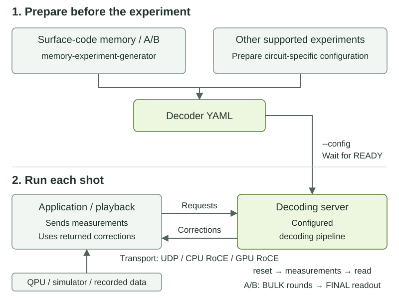

.. _decoding-server:

Decoding Server
===============

A server is a program that runs separately from its clients, receives their
requests, and returns results. The CUDA-Q QEC decoding server receives quantum
measurements and returns predicted logical corrections. Its clients can be
CUDA-Q applications, playback tools, or third-party quantum-control systems
that implement the server protocol.

The server loads a decoding pipeline from YAML, creates the decoder instances,
and handles requests over a configured transport. It lets a controller use
the decoders without hosting them in its own process. You can also run the
server and a simulated client on the same machine to test their interaction
before connecting quantum hardware. Local simulation can instead keep the
decoders and simulator in one process, as in
:doc:`Getting Started with Realtime Decoding
</examples_rst/qec/getting_started_realtime_decoding>`.

The **prebuilt decoding-server Docker image** includes the server, configuration
generator, playback emulator, and client examples. No server build is required.
The two examples demonstrate different ways to supply measurements to the
same server:

* :doc:`Realtime Decoding from a Quantum Kernel or FPGA
  </examples_rst/qec/realtime_decoding_demo>` runs a quantum circuit that sends
  measurements and receives corrections during execution. It also covers
  feeding pre-generated measurements from a real FPGA over RoCE.
* :ref:`Playback Against a Decoding Server <playback-server-example>` uses a
  software client to replay
  timed measurement and correction requests without executing a quantum
  circuit. The all-zero shot checks configuration and communication rather
  than decoding accuracy or hardware feedback latency.

Workflow at a Glance
--------------------

   Configuration happens before the run. Measurements and corrections flow
   between the client and server during each shot. Available transports depend
   on the installed package and dispatch mode.

1. **Prepare the configuration.** For supported surface-code memory experiments,
   use :ref:`decoding-server-memory-configuration`. Otherwise, prepare a
   detector error model for the exact circuit. The YAML identifies the decoder,
   measurement mapping and observables.
2. **Start the server.** Load that YAML and wait for
   ``QEC_DECODING_SERVER_READY`` before sending requests.
3. **Send measurements and read the correction.** Reset the decoder, send
   measurements in the configured order, including any required final readout,
   then request corrections.
   An enqueue acknowledgement is not a completed decode. Apply the returned
   logical flip bits to the raw logical readout once, and check the result.

.. _decoding-server-container-setup:

Set Up the Prebuilt Container
-----------------------------

Use a **Linux x86-64 Docker host** with Docker access. Run
commands on the host unless a section says to run inside the container. The
:ref:`Playback Against a Decoding Server <playback-server-example>` and
:ref:`packaged surface-code client <decoding-server-packaged-client>` use this
setup with UDP host networking and one decoder with ID 0. They check
functionality; they do not establish a QPU feedback-latency guarantee.

The CPU examples need no GPU or host CUDA-Q SDK. GPU decoders require a
compatible NVIDIA GPU, driver and NVIDIA Container Toolkit.

Get the Prebuilt Package
^^^^^^^^^^^^^^^^^^^^^^^^

Use the **CUDA-Q QEC decoding-server image** for this setup. The same image
includes the server, ``memory-experiment-generator``, ``playback-emulator``,
and the compiler and headers for the CUDA-Q client examples.
The general CUDA-Q QEC library and development images are different packages.

Set ``DECODING_SERVER_IMAGE`` once for all examples. Run these commands
**on the host**:

.. code-block:: bash

   export DECODING_SERVER_IMAGE='nvcr.io/nvidia/quantum/cudaq-decoding:cu13-latest'
   docker pull "$DECODING_SERVER_IMAGE"

The image includes surface-code example sources under ``/root/examples``.
Available decoders depend on the plugins shipped with the release; a generator
profile does not install its decoder.
Keep the server, generator, playback emulator and compiled clients on the same
image version. Additional plugins must be built against a compatible SDK; see
`Use a Custom Decoder Plugin`_.

Prepare the Run Directory
^^^^^^^^^^^^^^^^^^^^^^^^^

Create the shared run directory and its memory-experiment subdirectory
**on the host**:

.. code-block:: bash

   export QEC_RUN_DIR="$HOME/qec-decoding-server-runs"
   mkdir -p "$QEC_RUN_DIR/memory-experiment"
   cd "$QEC_RUN_DIR"

Store configurations, schedules, compiled clients and model files under
``QEC_RUN_DIR``. The :ref:`Playback Against a Decoding Server
<playback-server-example>` example provides its schedule inline.
A source checkout is not required.

.. _decoding-server-container-shell:

Open the Decoding-Server Container
^^^^^^^^^^^^^^^^^^^^^^^^^^^^^^^^^^

Run this command **on the host** to create a reusable container. For GPU
decoders, including the color-code AI example, add ``--gpus all`` when creating
the container. GPU access cannot be added later to an existing container.

.. code-block:: bash

   docker run -it --name qec-decoding --network host \
     --mount "type=bind,src=$QEC_RUN_DIR,dst=$QEC_RUN_DIR" \
     --workdir "$QEC_RUN_DIR" --env QEC_RUN_DIR \
     --entrypoint bash "$DECODING_SERVER_IMAGE"

The shell is now **inside the container**, in the shared run directory.
The server, generator and playback emulator are already installed.
Server and client commands below run here unless labelled **on the host**.
Start each example in this shared run directory; ``cd "$QEC_RUN_DIR"`` returns
to it after working in a subdirectory.

To open a second shell, run this command in another **host terminal**:

.. code-block:: bash

   docker exec -it qec-decoding bash

Both shells share the files in ``QEC_RUN_DIR``. Stop each server with Ctrl+C
before starting another configuration on the same port. Exiting the second
shell and then the original shell stops the container without removing it.
For later sessions, reopen the stopped container with
``docker start -ai qec-decoding`` instead of repeating ``docker run``.

.. _decoding-server-memory-configuration:

Configure a Surface-Code Memory Experiment
------------------------------------------

``memory-experiment-generator`` prepares YAML for **surface-code memory
experiments using a parallel-window task graph**. This graph uses two
interleaved window families, A and B. It is not a general
configuration generator for every code, circuit or decoder. Its model profiles
are:

* ``pymatching``: PyMatching.
* ``nv-fusion-decoder``: NV-Fusion.
* ``nv-qldpc-decoder``: Relay BP.
* ``single_error_lut`` and ``multi_error_lut``: lookup-table decoders.

The selected decoder must be installed and support the generated A/B windows;
model generation alone does not verify runtime compatibility. Color-code
experiments and Ising/TRT models are not generated by this tool. Other circuits
require their own model and decoder configuration.

The tool creates the server configuration, including the model and BULK/FINAL
measurement mappings. It does not supply measurements or start the server.

The main choices are:

* ``--distance``: odd and at least 3; ``--basis``: X or Z.
* ``--rounds=T``: at least four extraction rounds, **excluding** the final
  data-qubit readout. For example, use ``--rounds=1000`` for 1,000 extraction
  rounds plus one readout. This is not the number of shots.
* ``--error-rate``: the circuit's CNOT depolarization probability, not a
  target logical-error rate. It must match the experiment's noise model.
* ``--decoder``: one of the installed decoder profiles listed above. Additional
  parameters use ``--decoder-arg=NAME=VALUE``.
* ``--logical-qubits=N``: N independent patches, assigned decoder IDs
  ``0`` through ``N-1``; this is not a coupled multi-patch experiment.

For the A/B parallel-window example and its configuration, see
:doc:`Parallel Window </examples_rst/qec/task_graph_parallel_window>`.
The :ref:`Playback Against a Decoding Server <playback-server-example>` example
shows the complete sequence: generate the YAML, start the server, send
measurements, and check the result.

.. _decoding-server-measurements:

Send the Experiment's Measurements
^^^^^^^^^^^^^^^^^^^^^^^^^^^^^^^^^^

For each independent shot, reset the patch's decoder, send chronological **raw
measurements** through BULK mapping ID ``0``, then send the terminal data-qubit
readout through FINAL mapping ID ``1``. FINAL closes the shot; a correction read
does not replace it. For this surface-code layout, each extraction round has
``distance*distance-1`` measurement bits and the readout has
``distance*distance`` bits. Match the generated model's measurement ordering,
preparation basis and stabilizer circuit, not just these widths; do not submit
already-formed detector bits in place of measurements.

In a CUDA-Q kernel, use ``enqueue_syndromes_mapped`` to select the mapping ID;
see :ref:`C++ realtime decoding API <cpp_realtime_decoding_api>`.
For third-party clients, see the
`Decoding Server Message Format <https://github.com/NVIDIA/cudaq-qec/blob/main/libs/qec/tools/decoding-server/MESSAGE_FORMAT.md>`__.
Use interfaces matching the server package's version for both mapped-input
and fixed-shot clients.

The generator explicitly selects ``output: corrections``. ``get_corrections``
therefore returns logical flip bits to XOR with the experiment's raw logical
readout **once**, not physical-qubit corrections or an already-corrected measurement.
For FPGA or third-party producers, use `Integrate a Third-Party Runtime`_ and
:doc:`/examples_rst/qec/realtime_decoding_demo` for transport setup. The YAML
does not set up the NIC, load FPGA firmware or adapt a producer's measurement
layout.

.. _decoding-server-color-code:

Color-Code AI Predecoding
-------------------------

The server supports color-code AI predecoding through ``trt_decoder`` using
a matching exported ONNX model and circuit-specific YAML configuration.
The surface-code memory generator does not prepare color-code configurations.

See :doc:`AI Predecoding <ai_predecoding>` for how the neural network and
residual decoder work together.

For model preparation and the complete Ising plus Chromobius example, see
:doc:`/examples_rst/qec/color_code_demo`. Its model, software and GPU
prerequisites apply to that example, not to the CPU playback and
packaged-client examples.

Once a validated configuration and model are available, start the server with
that YAML through the ``--config`` option. A QPU client,
CUDA-Q application or playback emulator can then send the matching measurements
and request corrections. Keep the model files in the shared run directory so
the server can access them.

Use a Custom Decoder Plugin
---------------------------

The server can load an additional C++ decoder from a shared library (``.so``)
without rebuilding the server. Build the plugin on a development host or in a
separate build container, then deploy the library to the server container.
The workflow does not require a compiler in the decoding-server image.

Implement and Build the Plugin
^^^^^^^^^^^^^^^^^^^^^^^^^^^^^^

Follow :ref:`Implementing a new decoder in C++ <qec-custom-decoder>` for the
``cudaq::qec::decoder`` interface and decoder registration. Choose a registered
name that does not conflict with an installed decoder. Register a parameter
schema if the decoder accepts YAML custom arguments; see
:ref:`Custom decoder parameters <qec-custom-decoder-schema>`. No schema is
required when ``decoder_custom_args`` is absent or empty.

For a decoder used directly by the server, support
``decode_result_type::observables`` and return logical flip bits. An algorithm
that predicts error frames can use ``project_errors_to_observables`` with the
model's observable matrix before returning its result.

Use the C++ SDK matching the server's CUDA-Q QEC release, CPU architecture and
C++ ABI. CUDA plugins also need compatible CUDA libraries and a supported GPU.
Rebuild plugins after an incompatible SDK change.

Copy the SDK headers and libraries from the existing ``qec-decoding`` container
to the **server host**:

.. code-block:: bash

   docker cp qec-decoding:/opt/nvidia/cudaq-qec "$QEC_RUN_DIR/cudaq-qec-sdk"
   export QEC_SDK_PREFIX="$QEC_RUN_DIR/cudaq-qec-sdk"

Use a new destination directory for the copy. If compilation runs on another
host or in a separate build container, transfer this SDK directory there and
set ``QEC_SDK_PREFIX`` to its location in that environment. The copied files
match the server package; a compatible compiler and any decoder-specific
development dependencies are still required.

In the **development environment**, build a decoder implemented in
``my_decoder.cpp`` with:

.. code-block:: bash

   c++ -std=c++20 -O3 -fPIC -shared my_decoder.cpp \
     -I "$QEC_SDK_PREFIX/include" -L "$QEC_SDK_PREFIX/lib" \
     -lcudaq-qec-decoders -Wl,-rpath,'$ORIGIN/..' \
     -o libmy_decoder.so

Add any libraries required by the decoder's implementation to the build and
make their runtime dependencies available in the server container. The RPATH
above locates the server's decoder library one directory above the plugin.

Deploy and Select the Plugin
^^^^^^^^^^^^^^^^^^^^^^^^^^^^

Transfer ``libmy_decoder.so`` to ``$QEC_RUN_DIR`` on the **server host**.
Stop the server process before installing the plugin. For the reusable
``qec-decoding`` container created above, run **on the host**:

.. code-block:: bash

   docker cp "$QEC_RUN_DIR/libmy_decoder.so" \
     qec-decoding:/opt/nvidia/cudaq-qec/lib/decoder-plugins/libmy_decoder.so

Copy only the additional plugin, not a replacement directory that hides the
bundled plugins. The file remains in this container across stop/start; a newly
created container needs the plugin deployed again.

Save the experiment's YAML as ``custom.yaml`` in ``$QEC_RUN_DIR`` and set the
decoder entry's ``type`` to its **registered decoder name**, such as
``my_decoder``, not the library filename. Supply the
model, measurement mapping and ``decoder_custom_args`` required by that decoder;
changing ``type`` alone does not make an unrelated model compatible.

Start a new server process **inside the container**:

.. code-block:: bash

   CUDAQ_LOG_LEVEL=info decoding_server \
     --config=custom.yaml --transport=udp --port=50000 --timeout=3600

Check the startup log for ``Successfully loaded plugin`` with the deployed
filename, then wait for ``QEC_DECODING_SERVER_READY``. Run a small client or
playback case with a known expected correction before using the plugin for an
experiment. A loaded library alone does not establish decoding correctness.

Integrate a Third-Party Runtime
-------------------------------

A real QPU deployment uses the same server but needs a runtime adapter for its
control system. The hardware vendor supplies the QPU connection; the adapter
supplies decoder messages and a compatible transport.

A third-party runtime connects to the same server using the advertised endpoint
and decoder ID. For these UDP examples, use host address ``127.0.0.1:50000``
and decoder ID ``0``. A client on another machine needs the server host's
reachable address instead of ``127.0.0.1``.

The client workflow is:

1. Load a server configuration matching the circuit, model, measurement order
   and observables.
2. Wait for server readiness, then call ``reset_decoder`` before each independent
   experiment.
3. Send the configured measurements through ``enqueue_syndromes`` or the mapped
   enqueue API. Use the mapping IDs declared in the YAML; a mapping marked
   ``type: final`` closes the shot.
4. Call ``get_corrections`` and use the returned logical flip bits to correct the
   raw logical readout once. An enqueue acknowledgement is not the correction;
   ``NOT_READY`` means the correction is not available yet.

For CUDA-Q clients, see :ref:`cpp_realtime_decoding_api`. Third-party clients
must implement the protocol matching the server package; see
`Decoding Server Message Format <https://github.com/NVIDIA/cudaq-qec/blob/main/libs/qec/tools/decoding-server/MESSAGE_FORMAT.md>`__.
For CPU RoCE, GPU RoCE or FPGA deployment, follow the transport setup in
:doc:`/examples_rst/qec/realtime_decoding_demo`. Those hardware settings are separate from the
generator's YAML model configuration.

.. _decoding-server-host-loops:

Host Dispatch Loops
^^^^^^^^^^^^^^^^^^^

For host dispatch, the **loop shape** is selected with
``decoding_server --host-loop=threaded|unified`` when the server is launched
directly. The client example's ``run_realtime_decoding.sh`` does not expose
this option and always runs the default. ``threaded`` (the default) keeps the
provider's RX/TX threads plus one dispatcher thread per ring; ``unified`` runs
each host ring on a single
thread that drives the wire and the decoder call together through the
provider's CPU data plane; the server passes ``--unified`` to each host
ring's provider to select its CPU data plane (the in-tree ``udp`` provider
serves one; a provider without one is refused before READY). ``device_graph``
rings are unaffected, so a mixed configuration may run its host rings
unified; ``gpu_roce`` host rings are not supported in this mode.

Troubleshooting
---------------

.. list-table::
   :header-rows: 1
   :widths: 30 70

   * - Failure
     - Action
   * - Registry returns ``denied``
     - Confirm the image reference and package read access. Authenticate to
       the registry as instructed by the package owner. Do not continue until
       ``docker pull`` succeeds.
   * - Server exits before readiness
     - Read the server terminal output. Fix the reported YAML, missing plugin,
       model path or GPU error before rerunning.
   * - Server is not ready
     - Read the server terminal output. Wait for TensorRT engine construction
       to finish, or fix any initialization error before sending measurements.
   * - Output file already exists
     - Choose a new YAML or result filename to preserve previous runs.
   * - Playback has incomplete or failed reads
     - Check that the schedule, decoder ID, DEM, and measurement mapping belong
       to the same experiment. Inspect the returned status in the CSV.
   * - Client compilation fails
     - Follow :ref:`decoding-server-packaged-client-build` to run the packaged
       ``/root/examples/build.sh`` inside the container. Keep the client and
       server on the same image version.
   * - Model or engine initialization fails
     - Check GPU visibility, TensorRT/plugin availability, and paths under
       ``QEC_RUN_DIR``. Build engines on the deployment GPU/runtime.
   * - ``memory-experiment-generator`` is not found
     - Use the decoding-server package for this release, not a library or
       development image, an SDK archive or a decoders-only installation.
   * - Generated configuration is rejected by the server
     - Use the same image for generation and serving. Check the selected
       plugin, its required arguments and its support for the generated model.
   * - No final correction or incorrect logical result
     - Check the decoder ID, raw measurement order and FINAL mapping. Send
       the data readout, then apply the returned correction exactly once.

See Also
--------

* :doc:`/components/qec/realtime_decoding`: decoding concepts and configuration.
* :doc:`/examples_rst/qec/getting_started_decoding_task_graph`: graph construction and execution.
* :doc:`/components/qec/playback_emulator`: schedule syntax, CLI and Python interfaces, sources and sessions.
* :doc:`/examples_rst/qec/realtime_decoding_demo`: surface-code and real FPGA client examples.
* :doc:`/examples_rst/qec/color_code_demo`: color-code accuracy and performance studies.
* :doc:`/components/qec/decoders`: decoder capabilities and API references.
