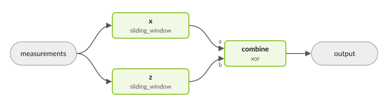

.. _decoding_task_graph:

Decoding Task Graphs
====================

A decoding task graph connects decoding steps into a pipeline. It accepts
measurements, routes data between nodes, and combines their results into
corrections to logical observables. With a logical-readout mapping and output,
it can also return the corrected logical measurements.

Use a task graph when decoding requires more than a single decoder call:
for example, to pass a predecoder's residual to another decoder, divide a long
measurement stream into windows, or choose an answer from an ensemble.
The graph manages the connections and execution order while each decoder
handles the error-correction problem assigned to it.

A detector error model (DEM) and a task graph describe different things.
The :doc:`DEM <dynamic_dem>` describes the experiment's faults, detectors,
observables, and measurement mappings. The task graph describes how decoders
and other processing steps use that information.

How Data Flows Through a Graph
------------------------------

A graph consists of **nodes** connected by **edges**. A node may run a decoder,
combine corrections, read logical observables, or organize work into windows.
An edge connects a named output port to a compatible input port. Building the
graph checks that the connected ports carry compatible types.

         global decoder, and an XOR node combines their logical corrections.

In this pipeline, the predecoder returns corrections and residual detection
events. The global decoder processes that residual, and an XOR node combines
the two sets of logical corrections. Each stage therefore handles the part
of the decoding problem assigned to it.

The DEM's measurement-to-detector mapping, ``D``, defines how raw measurements
form detection events. Its fault information describes the errors a decoder
must consider; ``O`` records which of those faults flip logical observables.
A downstream decoder receiving residual detection events consumes those
events directly.

The graph's external input is ``measurements`` and its correction outputs
are reached through ``output``. Nodes are listed in data-flow order. A node
without its own ``dem_chunks`` specification uses the enclosing decoder's DEM.
The :ref:`reference <task_graph_reference>` describes node kinds, ports, and
result types.

Complete Shots and Streaming
----------------------------

**Complete-shot decoding** processes a measurement record that is already
available. ``run()`` returns the correction from one graph output;
``run_batch()`` processes a collection of shots. For several correction
outputs, ``run_all()`` returns one result per output. This path is useful for
offline experiments and testing.

**Streaming decoding** accepts rounds through ``enqueue_syndrome()`` and
processes them as the configured nodes become ready. Window nodes collect the
rounds they need; native streaming decoders process incoming rounds through
their own streaming interface. Tag the last round ``FINAL`` to end the shot.
This interface serves realtime decoding and can also be exercised with
synthetic or recorded measurements.

Streaming results include progress information as well as correction bits.
Use their status and coverage to determine which rounds have been committed;
a zero-valued correction can be a completed result. See
:ref:`Reading Streaming Results <task_graph_streaming_results>`.

Corrections and corrected logical measurements are separate outputs.
``run()`` and ``run_batch()`` return corrections. To read corrected logical
measurements, provide the DEM's ``m2o_sparse`` mapping and configure a logical
output. See :ref:`Logical Measurements <task_graph_logical_measurements>`
for readout, release, and reset rules.

Building a Task Graph
---------------------

You can declare a graph in a decoder configuration's ``task_graph`` YAML
block, which the decoding server reads, or construct it through the Python
and C++ APIs:

* ``from_spec`` places one decoder in a window. With ``num_rounds`` set, it
  uses the complete shot; with an unresolved repeating phase, it constructs
  a sliding window that advances one round at a time.
* ``combine`` joins two single-node graphs and XORs their correction outputs.
  Use it when the two corrections are intended to add. To choose between
  competing answers, use an ensemble.
* ``from_topology`` accepts explicit nodes and edges for other arrangements.

The :doc:`Getting Started with a Decoding Task Graph
</examples_rst/qec/getting_started_decoding_task_graph>` demonstrates construction,
complete-shot and batch decoding, streaming, and XOR composition in Python
and C++. Its full source files provide the DEM helper used by the snippets.

For more specialized pipelines, see
:doc:`Parallel Window </examples_rst/qec/task_graph_parallel_window>`
and :doc:`Decoder Ensembles </examples_rst/qec/task_graph_ensemble>`.
The :ref:`Reference section <task_graph_reference>` below covers configuration
and execution details.

.. _task_graph_reference:

Reference
---------

Configuration fields, node behavior, and result semantics for task graphs.
For API signatures, see the :ref:`C++ <decoding_task_graph_cpp_api>` and
:ref:`Python <decoding_task_graph_python_api>` task-graph references.

.. include:: decoding_task_graph_reference.inc
