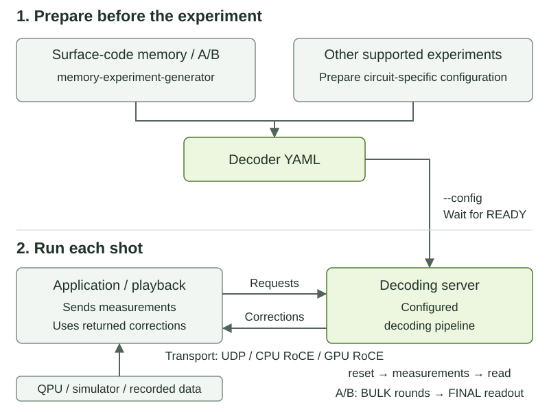

.. _decoding-server:

Deploying the Decoding Server with Docker
=========================================

The CUDA-Q QEC decoding server runs classical decoders independently of the
program controlling a quantum processor (QPU). A runtime sends measurements to
the server and receives predicted logical corrections. The runtime can be
CUDA-Q or a third-party control system that implements the server protocol.

This page shows how to use the **prebuilt Docker package**. You never build the
server. The playback examples run without a QPU. The CUDA-Q examples compile
only the application that sends measurements to the packaged server.

Workflow at a glance
--------------------

   Configuration happens before the run. Measurements and corrections flow
   between the client and server during each shot.

1. **Prepare the configuration.** For supported surface-code A/B experiments,
   use `Generate a memory-experiment configuration`_. Otherwise, prepare a model
   for your exact circuit. The YAML identifies the decoder, measurement mapping
   and observables.
2. **Start the server.** Load that YAML and wait for
   ``QEC_DECODING_SERVER_READY`` before sending requests.
3. **Run and verify a shot.** Reset the decoder, send measurements in order
   (including FINAL readout for generated A/B graphs), then request corrections.
   An enqueue acknowledgement is not a completed decode. Apply the returned
   logical flip bits to your raw logical readout once, and check the result.

Intended use cases
------------------

**Connect a QPU and a third-party runtime.** The control system measures the
QPU's qubits. Its runtime sends those measurements to a configured decoder,
requests logical corrections, and uses them to interpret logical measurements
or make feedback decisions. The server does not control the QPU or choose the
quantum experiment. See `Integrate a third-party runtime`_ for the contracts
that the runtime must implement.

**Test decoding without a QPU.** The playback emulator sends scheduled decoder
requests using recorded or simulated measurements. Use this path to verify
configuration and connectivity, and to evaluate decoding accuracy against
known logical outcomes. Start with `Playback emulator`_.

**Run a CUDA-Q surface-code program.** A CUDA-Q application sends measurements
while its circuit executes and receives corrections from the same Docker
server. The examples here use Stim to simulate the QPU and require no physical
QPU. Start with `CUDA-Q examples: surface-code programs`_.

**Configure a streaming surface-code memory experiment.** Use
``memory-experiment-generator`` to write a compact YAML configuration for the
A/B parallel-window task graph, then give that file to the server. Start with
`Generate a memory-experiment configuration`_. The tool prepares the model;
your application or playback client still supplies the measurements.

See :doc:`/components/qec/realtime_decoding` for model and matrix conventions.

Before you start
----------------

Use a **Linux x86-64 Docker host** with Docker access and Python 3.10 or later. Run
commands on the host unless a section says to run inside the container. These
walkthroughs use UDP host networking and one decoder with ID 0. They check
functionality; they do not establish a QPU feedback-latency guarantee.

The connectivity check and surface-code examples need no GPU or host CUDA-Q
SDK. The color-code AI example additionally needs a compatible NVIDIA GPU,
driver, NVIDIA Container Toolkit, Git, and host Python 3.12 with ``venv`` for
exporting the model. The server, playback emulator, and CUDA-Q application run
in the Docker package.

Get the prebuilt package
^^^^^^^^^^^^^^^^^^^^^^^^

Choose the package for the walkthrough you want to run:

.. list-table::
   :header-rows: 1
   :widths: 30 30 40

   * - Package
     - Image variable
     - Walkthrough
   * - Pinned staging preview (October 22, 2026)
     - ``DECODING_SERVER_IMAGE``
     - Fixed-shot playback and compiled CUDA-Q clients below; no generator.
   * - Current decoding-server package containing the generator
     - ``MEMORY_EXPERIMENT_IMAGE``
     - `Generate a memory-experiment configuration`_; prebuilt tools, no client
       compilation.

The references here use NGC staging and require package-owner-granted access;
they are not public production images. General CUDA-Q QEC images are separate
packages, not substitutes for the decoding-server package. Keep each
walkthrough's server and clients on its selected image.

Sign in to NGC using the account granted staging access. Select organization
``nvstaging`` and team ``cudaq-qec``. Generate a personal API key with
**NGC Catalog** and **NVIDIA Private Registry** access in
`NGC API Keys <https://org.ngc.nvidia.com/account/api-keys>`__.
Run the following on the Docker host, entering that key at the password prompt:

.. code-block:: bash

   docker login nvcr.io --username '$oauthtoken'
   export DECODING_SERVER_IMAGE='nvcr.io/nvstaging/cudaq-qec/cudaq-decoding@sha256:08c1926453a87e37ec4f4f30c817247fd8dde3d02a63080bc741a5c22bd5a88a'
   docker pull "$DECODING_SERVER_IMAGE"
   docker run --rm --entrypoint decoding_server "$DECODING_SERVER_IMAGE" --help
   docker run --rm --entrypoint playback-emulator "$DECODING_SERVER_IMAGE" --help
   docker run --rm --entrypoint ls "$DECODING_SERVER_IMAGE" \
     /opt/nvidia/cudaqx/lib/decoder-plugins

Successful login confirms authentication; the pull must also succeed to confirm
image access. Never put an API key in these commands or share it in logs.
For current key-management instructions, see the
`NGC user guide <https://docs.nvidia.com/ngc/latest/ngc-user-guide.html>`__.

Both ``--help`` commands must print their usage information (the server may
return exit status 1 for ``--help``). This pinned preview contains the server,
playback emulator, CUDA-Q compiler and headers, and surface-code example sources under
``/root/examples``. It includes PyMatching, Chromobius, and TensorRT decoder
plugins; lookup-table and sliding-window decoding are built into QEC. It does
not include the optional NVIDIA qLDPC plugin, a Python interpreter, or Python
QEC bindings. Do not copy plugins from other image versions into it.

Prepare the example directory
^^^^^^^^^^^^^^^^^^^^^^^^^^^^^

Create a directory for inputs and results:

.. code-block:: bash

   export QEC_RUN_DIR="$HOME/qec-decoding-server-runs"
   mkdir -p "$QEC_RUN_DIR"
   cd "$QEC_RUN_DIR"

Save these three downloads in that directory with their displayed filenames:
:download:`run_package_example.py <../../examples/qec/decoding_server/run_package_example.py>`,
:download:`config.yaml <../../examples/qec/decoding_server/config.yaml>`, and
:download:`schedule.txt <../../examples/qec/decoding_server/schedule.txt>`.
If you already have the source checkout containing this guide, you can copy
them from ``docs/sphinx/examples/qec/decoding_server/`` instead.
A source checkout is not needed for the walkthroughs.

The launcher starts the packaged server on an available UDP port, waits for
readiness, runs a client in a second container using the same image, then stops
and removes its containers. It saves client output and a separate
``.server.log`` file. It fails on startup errors, client errors, incomplete
corrections, or server decoder errors. Output files must not already exist;
choose a new output name when repeating a run.

All configurations, schedules, compiled clients, and models must remain under
``QEC_RUN_DIR``. The launcher mounts this directory at the same absolute path
inside both containers so that generated paths remain valid. Leave the terminal
in this directory for the remaining commands.

Generate a memory-experiment configuration
------------------------------------------

``memory-experiment-generator`` prepares YAML for **surface-code memory
experiments using the A/B parallel-window task graph**. It is not a general
configuration generator for every code, circuit or decoder. Its model profiles
are:

* ``pymatching`` — PyMatching.
* ``nv-fusion-decoder`` — NV-Fusion.
* ``nv-qldpc-decoder`` — Relay BP.
* ``single_error_lut`` and ``multi_error_lut`` — lookup-table decoders.

The selected decoder must be installed and support the generated A/B windows;
model generation alone does not verify runtime compatibility. Color-code
experiments and Ising/TRT models are not generated by this tool. Other circuits
require their own model and decoder configuration.

The tool writes one file containing the repeating model, decoder settings and
BULK/FINAL input mappings, without expanding the full DEM for every requested
round. The server constructs and runs the A/B graph. The generator does not
start the server, sample measurements or configure an FPGA.

Open the current package
^^^^^^^^^^^^^^^^^^^^^^^^

Run this block **on the host**, after NGC login. It pins the Linux x86-64,
CUDA 13 staging package tested with this generator walkthrough on November 3,
2026. This differs from the older preview used by the fixed-shot walkthroughs.

To try a newer package instead, the moving staging tag
``nvcr.io/nvstaging/cudaq-qec/cudaq-decoding:cu13-latest`` is available. Record
its resolved digest and recheck the walkthrough before comparing results.

.. code-block:: bash

   export MEMORY_EXPERIMENT_IMAGE='nvcr.io/nvstaging/cudaq-qec/cudaq-decoding@sha256:aa44bfd9cac5d0aed08799c6c489f9521175dbe653f98becf59f769d316d5416'
   export QEC_RUN_DIR="$HOME/qec-decoding-server-runs"
   mkdir -p "$QEC_RUN_DIR/memory-experiment"
   docker pull "$MEMORY_EXPERIMENT_IMAGE"
   docker run --rm -it --name qec-memory --network host \
     --mount "type=bind,src=$QEC_RUN_DIR,dst=$QEC_RUN_DIR" \
     --workdir "$QEC_RUN_DIR" --entrypoint bash "$MEMORY_EXPERIMENT_IMAGE"

You are now **inside the container**, in the host-backed run directory. The
generator is already built and installed; no compilation or additional image
is needed. Run ``memory-experiment-generator --help`` here before continuing.
If it is absent, request a newer package containing the generator; do not use
the old pinned preview or substitute an SDK image.

Generate the YAML
^^^^^^^^^^^^^^^^^

Still **inside the container**, enter the ``memory-experiment`` directory
created on the host above. It is shared through the bind mount. Generate a
distance-3, Z-basis experiment with 26 extraction rounds and PyMatching:

.. code-block:: bash

   cd memory-experiment
   memory-experiment-generator \
     --distance=3 --rounds=26 --basis=Z --error-rate=0.001 \
     --decoder=pymatching --output=memory.yaml

Wait for ``Generated server configuration: ...`` and exit status zero before
using the file. The output directory must exist; an existing file or symlink
is never overwritten. Choose another filename when changing an experiment.

The main choices are:

* ``--distance``: odd and at least 3; ``--basis``: X or Z.
* ``--rounds=T``: at least four extraction rounds, **excluding** the final
  data-qubit readout. For example, use ``--rounds=1000`` for 1,000 extraction
  rounds plus one readout. This is not the number of shots.
* ``--error-rate``: the circuit's CNOT depolarization probability, not a
  target logical-error rate. It must match your intended noise model.
* ``--decoder``: one of the installed decoder profiles listed above. Additional
  parameters use ``--decoder-arg=NAME=VALUE``.
* ``--logical-qubits=N``: N independent patches, assigned decoder IDs
  ``0`` through ``N-1``; this is not a coupled multi-patch experiment.

A/B commit and buffer widths default to the code distance. Leave those defaults
for a first run. ``--help`` lists geometry overrides, ``--decoder-arg`` and
``--pattern-arg`` options. Omitting ``--workers-per-graph`` leaves this example
synchronous: windows are decoded one at a time on the calling thread.
``--workers-per-graph=N`` enables a worker pool for each patch; more workers can
increase memory use and are not necessarily faster.

Start the server and check one shot
^^^^^^^^^^^^^^^^^^^^^^^^^^^^^^^^^^^

In this container terminal, start the CPU PyMatching server using the generated
file. Leave it running in the foreground:

.. code-block:: bash

   QEC_DECODING_SERVER_STATS=1 decoding_server \
     --config=memory.yaml --transport=udp --port=50000 --timeout=3600

Wait for ``QEC_DECODING_SERVER_READY`` and ``ring0=50000`` before sending data.
If startup fails, inspect its diagnostic rather than treating YAML generation
as a successful decoding test. Choose another free port if needed and use the
same port in the client.

On the **host**, download
:download:`memory_schedule.txt <../../examples/qec/decoding_server/memory_schedule.txt>`
to ``$QEC_RUN_DIR/memory-experiment/memory_schedule.txt``. That directory is
shared with the container. Alternatively, save the text below at that path.
This synthetic, all-zero shot sends 26 eight-bit stabilizer
rounds followed by a nine-bit data readout, matching the distance-3 configuration
above. It checks the configuration-to-server handoff, not accuracy or performance:

.. literalinclude:: ../../examples/qec/decoding_server/memory_schedule.txt
   :language: text

In a **second host terminal**, open another shell in the named container:

.. code-block:: bash

   docker exec -it qec-memory bash

Then run these commands **inside that shell**. Docker reuses the container's
configured working directory, so ``memory-experiment`` is the same shared
directory created above:

.. code-block:: bash

   cd memory-experiment
   playback-emulator \
     --config=memory.yaml --schedule=memory_schedule.txt \
     --backend=udp --udp-endpoint=0:127.0.0.1:50000 --tick=1ms \
     --out=memory-result.csv

In ``get_corrections 0 return_size=1``, ``0`` is the expected correction bit;
``return_size=1`` requests one bit. Pass ``--config`` to playback too: its
``enqueue_data`` operation uses the YAML's FINAL mapping. Check that the
correction row has ``status=0``,
``read_completed=1``, ``correction_bits=0`` and ``correction_mismatch=0``, with
zero server errors. ``stream`` and ``enqueue_data`` complete with status ``100``.
Stop the server with Ctrl+C in its original terminal; the final statistics
should show ``errors=0``. Exit the second shell, then the original shell to
remove the ``--rm`` container. The YAML, schedule and CSV remain on the host
under ``$QEC_RUN_DIR/memory-experiment``. These are functional checks, not an
end-to-end latency or throughput benchmark.

Send your experiment's measurements
^^^^^^^^^^^^^^^^^^^^^^^^^^^^^^^^^^^

For each independent shot, reset the patch's decoder, send chronological **raw
measurements** through BULK mapping ID ``0``, then send the terminal data-qubit
readout through FINAL mapping ID ``1``. FINAL closes the shot; a correction read
does not replace it. For this surface-code layout, each extraction round has
``distance*distance-1`` measurement bits and the readout has
``distance*distance`` bits. Match the generated model's measurement ordering,
preparation basis and stabilizer circuit, not just these widths; do not submit
already-formed detector bits in place of measurements.

In a CUDA-Q kernel, use ``enqueue_syndromes_mapped`` to select the mapping ID;
see :doc:`/api/qec/cpp_realtime_decoding_api`. For third-party clients, see the
current `Decoding Server Message Format <https://github.com/NVIDIA/cudaq-qec/blob/main/libs/qec/tools/decoding-server/MESSAGE_FORMAT.md>`__.
Match those interfaces to your server package's version; the older pinned
references below describe its fixed-shot clients.

The YAML records ``T+1`` raw rounds, including readout. FINAL determines the
actual shot length; the repeating model accepts valid shots at or above its
minimum of four extraction rounds plus readout. Keep the first test at the
requested length before varying it.

The generator explicitly selects ``output: corrections``. ``get_corrections``
therefore returns logical flip bits to XOR with your own raw logical readout
**once**, not physical-qubit corrections or an already-corrected measurement.
For FPGA or third-party producers, use `Integrate a third-party runtime`_ and
:doc:`realtime_decoding_demo` for transport setup. The YAML does not set up the
NIC, load FPGA firmware or adapt a producer's measurement layout.

Playback emulator
-----------------

The playback emulator replaces the runtime and QPU with a schedule of decoder
calls. It still sends those calls to the **separate packaged decoding server**.
The following examples select the UDP backend. Selecting ``inproc`` would run
the decoder inside the emulator and would not test the server.

A schedule line contains a trigger (when to send), an operation, and optional
``key=value`` arguments. In this page's schedules, ``0 reset`` resets at tick zero;
``1 stream source=0b00000000 rounds=26 every=1`` starts at tick one and sends
26 rounds one tick apart. ``-`` sends immediately after the previous event
finishes sending its requests; it does not wait for their replies.
``get_corrections 0 return_size=1`` also supplies an expected correction bit,
``0``. These walkthroughs demonstrate the CLI; they are not a complete schedule
grammar or Python API reference.

Check connectivity first
^^^^^^^^^^^^^^^^^^^^^^^^

Run this CPU-only check before preparing a model:

.. code-block:: bash

   python3 run_package_example.py --image "$DECODING_SERVER_IMAGE" \
     --config config.yaml --schedule schedule.txt \
     --shots 1 --expect-no-errors --output connectivity.csv

The supplied configuration uses a synthetic three-bit identity mapping with
``multi_error_lut``. The schedule resets decoder 0, sends ``010``, then reads
three correction bits. This is a connectivity check, not a quantum-code
experiment.

.. literalinclude:: ../../examples/qec/decoding_server/schedule.txt
   :language: text

A successful run prints:

.. code-block:: text

   Completed shots: 1; logical mismatches: 0; fraction: 0
   Server dispatched 3 requests; saved client output: .../connectivity.csv

``connectivity.csv.server.log`` must report one decode, one correction, and zero
errors. In the CSV, reset and read use status ``0``; the enqueue is recorded as
a completed one-round stream with status ``100``. A successful ``enqueue_data``
final-readout event also uses stream-completion status ``100``. The read contains
``read_completed=1``, ``correction_bits=010``, and ``correction_mismatch=0``.
The launcher checks these completion conditions automatically.

For the packaged emulator's schedule, source, and session options, run
``playback-emulator --help`` inside the image as shown above.

.. _decoding-server-color-code:

Color-code-enabled AI decoder
^^^^^^^^^^^^^^^^^^^^^^^^^^^^^

``Ising-Decoder-ColorCode-1-Fast`` is a published neural-network predecoder for
color codes. In the server it runs through ``trt_decoder`` using TensorRT.
It predicts observable flips and residual detectors; Chromobius decodes the
residual, and the server combines the results into logical corrections.

The example below compares **Chromobius alone** with **Ising + Chromobius**
using exactly the same simulated measurements and expected logical outcomes.
It uses a distance-5, Z-basis superdense color-code memory circuit with five
rounds and physical error probability 0.001. It is a fixed-shot example.
A surface-code model or surface-code measurement mapping cannot replace the
color-code model and mapping.

Color-code example: prepare once, run both decoders
^^^^^^^^^^^^^^^^^^^^^^^^^^^^^^^^^^^^^^^^^^^^^^^^^^^

Download
:download:`color_code_demo.py <../../examples/qec/color_code_demo/color_code_demo.py>`
into ``QEC_RUN_DIR``. Preparation runs on the host, exports ONNX, and writes
inputs for the packaged server. It requires Python dependencies but no CUDA-Q
SDK and does not build the server.

Create a virtual environment and install the inference dependencies from the
pinned Ising source revision:

.. code-block:: bash

   python3.12 -m venv .venv
   source .venv/bin/activate
   python3 -m pip install --upgrade pip
   python3 -m pip install torch==2.14.1 --index-url https://download.pytorch.org/whl/cpu
   mkdir -p model-deps
   git clone https://github.com/NVIDIA/Ising-Decoding.git model-deps/Ising-Decoding
   git -C model-deps/Ising-Decoding checkout 33acb152e403bc189f2effdb07f1a87b34c745f1
   python3 -m pip install -r model-deps/Ising-Decoding/code/requirements_public_inference.txt
   python3 -m pip install huggingface_hub onnx

Use a fresh ``model-deps`` directory. When reusing an existing Ising checkout,
its HEAD must match the revision above; preparation checks this before using it.
On Linux distributions that package ``venv`` separately, install the matching
``python3.12-venv`` package before creating the environment.

First prepare and run Chromobius without downloading AI weights:

.. code-block:: bash

   python3 color_code_demo.py --prepare-only --baseline-only \
     --deps "$PWD/model-deps" --distances 5 --shots 100 --seed 1234
   python3 run_package_example.py --image "$DECODING_SERVER_IMAGE" \
     --config config_chromobius_d5.yaml --schedule schedule_d5.txt \
     --shots 100 --output color-chromobius.csv

For the AI comparison, accept the model's terms at
`Ising-Decoder-ColorCode-1-Fast <https://huggingface.co/nvidia/Ising-Decoder-ColorCode-1-Fast>`__
and authenticate the host's ``hf`` CLI. Enter your Hugging Face token only at
its prompt. Then prepare the AI model using the same distance, shots, and seed:

.. code-block:: bash

   hf auth login
   python3 color_code_demo.py --prepare-only --deps "$PWD/model-deps" \
     --distances 5 --shots 100 --seed 1234
   docker run --rm --gpus all --entrypoint nvidia-smi "$DECODING_SERVER_IMAGE"
   python3 run_package_example.py --image "$DECODING_SERVER_IMAGE" \
     --config config_trt_decoder_d5.yaml --schedule schedule_d5.txt \
     --gpu --writable --shots 100 --output color-ising.csv

Full preparation writes ``pre_d5.onnx``, ``dem_d5.txt``, ``schedule_d5.txt``,
``config_chromobius_d5.yaml``, and ``config_trt_decoder_d5.yaml``. The baseline
step omits the ONNX and AI configuration. The second preparation deterministically
regenerates the same measurements for the comparison; keep the files together.
It does not load a decoder or start a server.

``--gpu`` exposes the GPU to the server. ``--writable`` lets the server save
``engine_d5.trt`` while building TensorRT from ONNX on that GPU. Construction
finishes before readiness; the default startup timeout is 600 seconds. If the
log shows ongoing construction at that limit, use a new output name and
``--startup-timeout 1800``. Engines depend on the GPU and TensorRT runtime;
regenerate them when either changes.

Both runs must complete 100 correction reads and report zero server errors.
The launcher prints the logical-mismatch count and fraction. A mismatch in
this experiment is a logical decoding error; it does not mean the transport
failed. A valid run can contain mismatches. This small, deliberately paced
run checks operation and is not an accuracy claim or a latency benchmark.
See :doc:`color_code_demo` for larger studies and uncertainties.

CUDA-Q examples: surface-code programs
--------------------------------------

The packaged ``surface_code-1`` program runs a distance-3 surface-code memory
circuit in Stim. Its ``-cqr`` variant streams measurements to the separate
server while the circuit executes. The following examples run 100 shots with
three rounds and CNOT error probability 0.001, using three decoders:

.. list-table::
   :header-rows: 1
   :widths: 25 75

   * - Decoder
     - Configuration
   * - ``pymatching``
     - CPU minimum-weight perfect matching.
   * - ``multi_error_lut``
     - CPU lookup table, using the example's lookup depth 2. Keep this small
       geometry because table size grows with code size and lookup depth.
   * - ``sliding_window``
     - CPU sliding window with PyMatching, window size 3, and step size 1.
       Here the window covers the three-round shot.

How the circuit uses the server
^^^^^^^^^^^^^^^^^^^^^^^^^^^^^^^

Each shot prepares one logical qubit in the logical-zero state, measures
three stabilizer rounds, and measures the data qubits in the Z basis. The
program sends each measurement group to decoder 0, then uses the returned
logical correction to update the parity of the final readout.

The following excerpts come from the
`complete packaged program <https://github.com/NVIDIA/cudaq-qec/blob/8e69945cb2d123d9ad53dc96c1cf992d77dc8bcd/libs/qec/unittests/realtime/app_examples/surface_code-1.cpp#L583>`__.
The build commands below compile that complete source, including register
allocation, code setup, noise configuration, and the host entry point.

The shot kernel first resets its decoder:

.. code-block:: cpp

   cudaq::qec::decoding::reset_decoder(decoder_ids[i]);

Its ``memory_circuit`` kernel prepares the patch and submits raw measurements:

.. code-block:: cpp

   patch logical(data, xstab_anc, zstab_anc);
   state_prep(logical);

   auto syndrome = stab_round(logical, x_stabilizers, z_stabilizers);
   cudaq::qec::decoding::enqueue_syndromes(decoder_id, syndrome);
   for (std::size_t r = 1; r < num_rounds; r++) {
     auto s = stab_round(logical, x_stabilizers, z_stabilizers);
     cudaq::qec::decoding::enqueue_syndromes(decoder_id, s);
   }

   auto data_meas = mz(data);
   cudaq::qec::decoding::enqueue_syndromes(decoder_id, data_meas);

The server's configured ``D_sparse`` map converts these measurements to
detectors. After computing the measured logical parity ``obs`` from
``data_meas``, the shot kernel reads and applies the predicted observable flip:

.. code-block:: cpp

   auto correction = cudaq::qec::decoding::get_corrections(
       static_cast<std::uint64_t>(decoder_ids[i]), num_observables,
       /*reset=*/false);
   if (correction[0]) {
     obs = !obs;
     num_corrections++;
   }

For three rounds, each shot sends one reset, four measurement groups (three
stabilizer rounds and the final data readout), and one correction request.
That gives the 600 server requests expected for 100 shots below. The correction
updates the reported logical observable; it is not a physical-qubit error mask.

Build the packaged client once
^^^^^^^^^^^^^^^^^^^^^^^^^^^^^^^

Compile only the application using the compiler and matching headers inside
the image. The server is already built. Save the executables under the shared
run directory so later containers can use them:

.. code-block:: bash

   export EXAMPLE_BUILD_DIR="$QEC_RUN_DIR/client-build"
   docker run --rm \
     --mount "type=bind,src=$QEC_RUN_DIR,dst=$QEC_RUN_DIR" \
     --workdir /root/examples --env BUILD_DIR="$EXAMPLE_BUILD_DIR" \
     --entrypoint bash "$DECODING_SERVER_IMAGE" -c './build.sh surface_code-1'
   test -f "$EXAMPLE_BUILD_DIR/surface_code-1-local"
   test -f "$EXAMPLE_BUILD_DIR/surface_code-1-cqr"

Use the image's example sources and build script together. An arbitrary host
SDK or a newer source checkout may use a different realtime protocol.

Generate configurations and run all three decoders
^^^^^^^^^^^^^^^^^^^^^^^^^^^^^^^^^^^^^^^^^^^^^^^^^^

Each iteration first writes a separate server YAML using the local executable.
The launcher then runs its matching ``-cqr`` client against the packaged server.
The block stops on the first error and supplies sliding-window options only
for that decoder. Run it in Bash.

.. code-block:: bash

   (
     set -e
     for DECODER in pymatching multi_error_lut sliding_window; do
       SW_ARGS=()
       if [ "$DECODER" = sliding_window ]; then
         SW_ARGS=(--sw_inner_decoder pymatching --sw_window_size 3 --sw_step_size 1)
       fi
       docker run --rm \
         --mount "type=bind,src=$QEC_RUN_DIR,dst=$QEC_RUN_DIR" \
         --workdir "$QEC_RUN_DIR" \
         --entrypoint "$EXAMPLE_BUILD_DIR/surface_code-1-local" "$DECODING_SERVER_IMAGE" \
         --distance 3 --num_rounds 3 --num_shots 100 --p_cnot 0.001 \
         --decoder_type "$DECODER" \
         "${SW_ARGS[@]}" \
         --save_dem "$QEC_RUN_DIR/surface-$DECODER.yaml"
       python3 run_package_example.py --image "$DECODING_SERVER_IMAGE" \
         --config "surface-$DECODER.yaml" --shots 100 --output "surface-$DECODER.log" \
         --client "$EXAMPLE_BUILD_DIR/surface_code-1-cqr" \
         --distance 3 --num_rounds 3 --num_shots 100 --p_cnot 0.001 \
         --decoder_type "$DECODER" \
         "${SW_ARGS[@]}" \
         --load_dem "$QEC_RUN_DIR/surface-$DECODER.yaml"
     done
   )

The launcher supplies the discovered UDP endpoint and
``CUDAQ_DEVICE_CALL_CHANNEL=host_dispatch`` to the client container. No server
port or host SDK environment variables need to be set manually.

Verify each surface-code run
^^^^^^^^^^^^^^^^^^^^^^^^^^^^

Each launch must print ``Client completed with external server routing
confirmed``. Its server log must contain:

.. code-block:: text

   QEC_DECODING_SERVER_DECODER_STATS id=0 decodes=100 enqueues=400 corrections=100 resets=100 errors=0
   QEC_DECODING_SERVER_DISPATCHED count=600

The launcher checks 100 decodes, at least 100 correction requests, zero server
errors, and nonzero dispatches. The client log must report
``CQR service dispatch count: 0``, confirming that decoding was routed externally.
The logs also contain the circuit's correction and logical-error counts;
those are experiment results, distinct from server errors.

These compiled-client examples cover fixed-duration shots. For generated
streaming A/B graphs, use `Generate a memory-experiment configuration`_ rather
than substituting a new YAML into these fixed-model clients. NVIDIA qLDPC and Fusion require
separate package variants containing their plugins and cannot be selected in
this pinned image. Surface-code Ising requires its own model and measurement
contract. See
:doc:`realtime_decoding_demo` for the surface-code Ising application and
:ref:`the Fusion API <nv_fusion_decoder_api_cpp>` for Fusion configuration.

Integrate a third-party runtime
-------------------------------

A real QPU deployment uses the same server but needs a runtime adapter for its
control system. The hardware vendor supplies the QPU connection; the adapter
supplies decoder messages and a compatible transport.

To keep a server running for a third-party UDP client, use the synthetic
connectivity configuration first. Run this in a dedicated terminal with the
same ``DECODING_SERVER_IMAGE`` and ``QEC_RUN_DIR`` values set:

.. code-block:: bash

   docker run --rm --name qec-decoding-server --network host \
     --mount "type=bind,src=$QEC_RUN_DIR,dst=$QEC_RUN_DIR,readonly" \
     --workdir "$QEC_RUN_DIR" --env QEC_DECODING_SERVER_STATS=1 \
     --entrypoint decoding_server "$DECODING_SERVER_IMAGE" \
     --config="$QEC_RUN_DIR/config.yaml" --transport=udp --port=50000 --timeout=3600

Wait for ``QEC_DECODING_SERVER_READY`` and confirm ``ring0=50000``. A client on
this host connects to ``127.0.0.1:50000`` and decoder ID 0. Stop the foreground
server with Ctrl+C, or run ``docker stop qec-decoding-server`` in another
terminal. Replace the synthetic configuration with a validated circuit
configuration before sending real measurements. For a GPU decoder, add
``--gpus all`` and allow writes to the run directory if building an engine.

The integration steps are:

1. Generate the configuration for the actual circuit, noise model,
   measurement ordering, and observables. Match the decoder ID and the number
   of correction bits to the runtime.
2. Implement ``reset_decoder``, ``enqueue_syndromes``, and ``get_corrections``
   using the references pinned to this image: the
   `Decoding Server Message Format <https://github.com/NVIDIA/cudaq-qec/blob/8e69945cb2d123d9ad53dc96c1cf992d77dc8bcd/libs/qec/tools/decoding-server/MESSAGE_FORMAT.md>`__
   and `CUDA-Q Realtime protocol <https://github.com/NVIDIA/cuda-quantum/blob/a67dc853396e84698fd5aa2761f62ef78945e666/realtime/docs/cudaq_realtime_message_protocol.md>`__.
   These specify framing, function IDs, packed-bit order, request correlation,
   and statuses. ``NOT_READY`` is not a valid correction.
3. Connect through the selected provider. UDP supports functional integration;
   CPU RoCE and GPU RoCE require the package's hardware deployment setup.
   A custom provider implements the matching
   `bridge interface <https://github.com/NVIDIA/cuda-quantum/blob/a67dc853396e84698fd5aa2761f62ef78945e666/realtime/include/cudaq/realtime/daemon/bridge/bridge_interface.h>`__.
   The third-party client does not need the CUDA-Q compiler.
4. Reset at the beginning of an independent shot, send every configured
   measurement group including the final readout, and read the logical
   correction. A full decoder reset clears shot state; the reset argument to
   ``get_corrections`` clears correction bits after reading them.
5. Validate known measurements first, then the live QPU stream. Measure the
   complete control-system-to-correction path under sustained load before
   relying on it for feedback deadlines.

The launcher on this page serves only one UDP host-dispatch decoder. For a
multi-decoder integration, route each decoder to its advertised
``ring<ID>`` endpoint. CPU RoCE ports are TCP rendezvous endpoints, not UDP data
ports. Configurations using GPU RoCE or device-graph dispatch put provider
selection and arguments in YAML; they cannot use this launcher's UDP flags.
Use the hardware deployment configuration supplied with that package.

Troubleshooting
---------------

.. list-table::
   :header-rows: 1
   :widths: 30 70

   * - Failure
     - Action
   * - Registry returns ``denied``
     - Confirm the image reference and package read access. Authenticate to
       the registry as instructed by the package owner. Do not continue until
       ``docker pull`` succeeds.
   * - Server exits before readiness
     - Read the server terminal output, or the saved ``.server.log`` when using
       the launcher. Fix the reported YAML, missing plugin, model path, or GPU
       error before rerunning.
   * - Startup times out
     - Read the server log. If TensorRT is still building an engine, increase
       ``--startup-timeout``. If initialization failed, fix that error first.
   * - Output file already exists
     - Choose a new ``--output`` filename. The launcher preserves prior runs.
   * - Playback has incomplete or failed reads
     - Check that the schedule, decoder ID, DEM, and measurement mapping belong
       to the same experiment. Inspect the returned status in the CSV.
   * - Client compilation fails
     - Use the packaged ``/root/examples/build.sh`` with ``--entrypoint bash``
       as shown above. Keep the client and server on the same image digest.
   * - Color-code preparation cannot import a Python module
     - Activate ``.venv`` and install the pinned Ising source's inference
       requirements. Preparation runs on the host, where Python is installed.
   * - Hugging Face returns ``401`` or ``403``
     - Accept the model's access terms using the same account authenticated by
       ``hf auth login``. The Chromobius-only preparation needs no model access.
   * - Model or engine initialization fails
     - Check GPU visibility, TensorRT/plugin availability, and paths under
       ``QEC_RUN_DIR``. Build engines on the deployment GPU/runtime.
   * - ``memory-experiment-generator`` is not found
     - Use a current decoding-server package containing the tool, not the
       older staging preview, an SDK archive or a decoders-only installation.
   * - Generated configuration is rejected by the server
     - Use the same image for generation and serving. Check the selected
       plugin, its required arguments and its support for the A/B windows.
   * - No final correction or incorrect logical result
     - Check the decoder ID, raw measurement order and FINAL mapping. Send
       the data readout, then apply the returned correction exactly once.

See also
--------

* :doc:`/components/qec/realtime_decoding` — decoding concepts and configuration.
* :doc:`realtime_decoding_demo` — surface-code and real FPGA client examples.
* :doc:`color_code_demo` — color-code accuracy and performance studies.
* :doc:`/components/qec/decoders` — decoder capabilities and API references.
