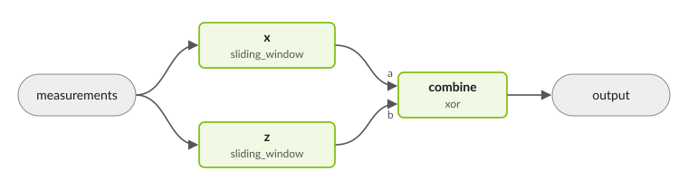

.. _decoding_task_graph_example:

Decoding Task Graphs
--------------------

A decoding task graph is a decoder pipeline. Measurements enter the graph,
flow through its nodes, and leave as corrections to the logical observables,
and, if the model reads them, as corrected logical measurements. A node
decodes, often by wrapping a decoder plugin such as PyMatching, or combines
results; edges carry values between nodes.

         corrections an xor node combines into the graph's output.

A graph runs in two ways:

* **Complete shots**: :meth:`~cudaq_qec.DecodingTaskGraph.run` decodes one
  shot and :meth:`~cudaq_qec.DecodingTaskGraph.run_batch` many, for offline
  analysis and testing.
* **Streaming**: :meth:`~cudaq_qec.DecodingTaskGraph.enqueue_syndrome` takes
  rounds as they arrive, and windows decode as soon as they hold enough
  rounds. This is the real-time QEC path.

Build a graph in Python or C++, or declare it in the ``task_graph`` block of a
decoder's YAML configuration, which the realtime decoding server reads.

To decode streams of any length with windows that decode at the same time, see
:doc:`task_graph_parallel_window`. For execution details, ensembles and other
advanced topics, see :doc:`task_graph_reference`.

Quick start: a sliding window
+++++++++++++++++++++++++++++

The simplest graph is one sliding-window node around an inner decoder. Its
model is a ``dem_chunks`` description of the experiment's rounds (see
:ref:`dyn_dem_example`).

.. code-block:: yaml

   decoders:
     - id: 0
       task_graph:
         type: sliding_window
         inner_type: single_error_lut # the inner decoder
       dem_chunks:
         seam: {from: next_round, to: prev_round}
         connections:
           - {from: init, to: bulk}
           - {from: bulk, to: bulk}   # bulk repeats
           - {from: bulk, to: final}
         phases:
           - name: init
             spec:
               num_faults: 9
               H_sparse: [0,1,5,-1, 1,2,6,-1, 2,3,7,-1, 3,4,8,-1]
               O_sparse: [0,-1]
               error_rates: [0.02,0.02,0.02,0.02,0.02,0.02,0.02,0.02,0.02]
           - name: bulk
             spec:
               num_faults: 9
               H_sparse: [0,1,5,-1, 1,2,6,-1, 2,3,7,-1, 3,4,8,-1]
               O_sparse: [0,-1]
               error_rates: [0.02,0.02,0.02,0.02,0.02,0.02,0.02,0.02,0.02]
           - name: final
             spec:
               num_faults: 5
               H_sparse: [0,1,-1, 1,2,-1, 2,3,-1, 3,4,-1]
               O_sparse: [0,-1]
               error_rates: [0.02,0.02,0.02,0.02,0.02]

* Without ``num_rounds``, the graph streams: the window decodes once per round.
* With ``num_rounds``, the graph decodes each complete shot once. Write
  ``type: single_window`` to require that.
* ``decoder_custom_args`` configure the inner decoder.

The same graph built in code:

.. tab:: Python

   .. literalinclude:: ../../examples/qec/python/decoding_task_graph.py
      :language: python
      :start-after: [Begin from_spec]
      :end-before: [End from_spec]

.. tab:: C++

   .. literalinclude:: ../../examples/qec/cpp/decoding_task_graph.cpp
      :language: cpp
      :start-after: [Begin from_spec]
      :end-before: [End from_spec]

   Compile and run with

   .. code-block:: bash

      nvq++ -lcudaq-qec -lcudaq-qec-decoders decoding_task_graph.cpp
      ./a.out

Decoding complete shots
+++++++++++++++++++++++

:meth:`~cudaq_qec.DecodingTaskGraph.run` decodes one shot:

.. tab:: Python

   .. literalinclude:: ../../examples/qec/python/decoding_task_graph.py
      :language: python
      :start-after: [Begin one-shot]
      :end-before: [End one-shot]

.. tab:: C++

   .. literalinclude:: ../../examples/qec/cpp/decoding_task_graph.cpp
      :language: cpp
      :start-after: [Begin one-shot]
      :end-before: [End one-shot]

:meth:`~cudaq_qec.DecodingTaskGraph.run_batch` decodes many:

.. tab:: Python

   .. literalinclude:: ../../examples/qec/python/decoding_task_graph.py
      :language: python
      :start-after: [Begin batch]
      :end-before: [End batch]

.. tab:: C++

   .. literalinclude:: ../../examples/qec/cpp/decoding_task_graph.cpp
      :language: cpp
      :start-after: [Begin batch]
      :end-before: [End batch]

A graph with more than one output returns one result per output from
``run_all``, in ``output_names()`` order.

Streaming
+++++++++

.. tab:: Python

   .. literalinclude:: ../../examples/qec/python/decoding_task_graph.py
      :language: python
      :start-after: [Begin streaming]
      :end-before: [End streaming]

.. tab:: C++

   .. literalinclude:: ../../examples/qec/cpp/decoding_task_graph.cpp
      :language: cpp
      :start-after: [Begin streaming]
      :end-before: [End streaming]

* Send one round per call: ``get_num_msyn_per_round()`` measurements. Larger
  chunks also work; the graph splits them.
* Tag the shot's last round ``FINAL``, as in
  ``enqueue_syndrome(syndrome, round_type.FINAL)``. It decodes whatever
  windows still hold, so the end of the shot is corrected. Untagged rounds
  never end a shot.
* Corrections accumulate across the shot. After ``FINAL``, the graph drops
  further rounds until ``clear_corrections()``, which consumes the
  corrections and starts the next shot. ``reset_decoder()`` also starts a
  new shot, discarding rounds not yet decoded.

Reading results
+++++++++++++++

``get_obs_corrections()`` returns the corrections, one byte per observable.
``streaming_result()`` also says whether they are ready and which rounds they
cover. For each graph output it reports:

* ``status``: ``PENDING`` before the output has published or after
  ``clear_corrections()``, ``AVAILABLE`` mid-shot, ``COMPLETE`` after
  ``FINAL``, or ``FAILED``. (In C++, lowercase.)
* ``coverage_begin_round`` and ``coverage_end_round``: the rounds the latest
  update committed, as a half-open range. For a parallel window, this is every
  round committed since the last ``clear_corrections()``.
* ``closure``: whether decoded windows were checked against their detectors
  (see :doc:`task_graph_parallel_window`).

A zero correction with status ``AVAILABLE`` is a real result. Synchronously,
``enqueue_syndrome`` also returns whether any node decoded; with
``async_streaming`` it returns ``False``, so read ``status`` instead.

.. _task_graph_logical_measurements:

Logical measurements
++++++++++++++++++++

A graph can return two results:

* **Corrections**, the flips of the logical observables:
  ``get_obs_corrections()``, ``run()`` and the decoding server's
  ``get_corrections``.
* **Logical measurements**, the raw logical readout with the corrections
  applied: ``get_logical_measurements()`` and the server's
  ``get_logical_measurements``.

Logical measurements need a model that reads the observables, through
``m2o_sparse`` (see :ref:`dyn_dem_example`), and a graph with a logical
output. ``parallel_window`` wires one with
``output: corrections_and_logical`` (see :doc:`task_graph_parallel_window`);
other graphs wire a ``logical_readout`` node (see
:ref:`task_graph_logical_output`).

* A logical measurement is *released* once its readout has arrived and every
  correction that can flip it is committed. A final readout is released at
  ``FINAL``. A mid-circuit readout is released mid-shot when the corrections
  are staged, as ``parallel_window``'s are; otherwise at ``FINAL``.
* ``get_logical_measurements(first, count)`` returns ``None`` (C++:
  ``nullptr``) until every measurement in the range is released.
* The logical output is the last of ``streaming_result().outputs``, with a
  ``released`` flag per measurement. It is not in ``output_names()``, and
  ``get_num_logical_measurements()`` gives its width.
* The logical measurements apply every correction of the shot, so the shot
  can be consumed only after ``FINAL``: ``clear_corrections()`` raises before
  then. ``reset_decoder()`` still abandons a shot.
* ``run`` and ``run_batch`` return corrections only.

Graphs of several nodes
+++++++++++++++++++++++

``task_graph.nodes`` lists the nodes and ``task_graph.edges`` wires them. A
node names its kind in ``type``, its inner decoder in ``inner``, and the kind's
parameters inline. This is the graph in the figure above:

.. code-block:: yaml

   task_graph:
     nodes:
       - id: x
         type: sliding_window
         window_size: 3               # rounds per decode
         step_size: 1                 # rounds to advance per decode
         inner: {type: single_error_lut}
       - id: z
         type: sliding_window
         window_size: 3
         step_size: 1
         inner: {type: single_error_lut}
         dem_chunks: {...}            # optional: this node's own model
       - id: combine
         type: xor
     edges:
       - {from: measurements, to: x}
       - {from: measurements, to: z}
       - {from: x, to: combine.a}
       - {from: z, to: combine.b}
       - {from: combine, to: output}

* ``measurements`` is the incoming shot and ``output`` the graph's result.
* An edge endpoint is a node id, with ``.port`` for a node that has named ports,
  such as ``xor``'s ``a`` and ``b``.
* A single node needs no edges: it is wired
  ``measurements → node → output``.
* List nodes in the order data flows. A node without its own ``dem_chunks``
  uses the decoder's.

:meth:`~cudaq_qec.DecodingTaskGraph.combine` builds the same two-branch graph
in code:

.. tab:: Python

   .. literalinclude:: ../../examples/qec/python/decoding_task_graph.py
      :language: python
      :start-after: [Begin combine]
      :end-before: [End combine]

.. tab:: C++

   .. literalinclude:: ../../examples/qec/cpp/decoding_task_graph.cpp
      :language: cpp
      :start-after: [Begin combine]
      :end-before: [End combine]

For any other topology, use
:meth:`~cudaq_qec.DecodingTaskGraph.from_topology` with a list of
:class:`~cudaq_qec.TaskGraphNodeConfig` nodes and their edges. In code, a
node's ``kind``, ``decoder_type``, ``params`` and ``node_params`` hold what
YAML writes as ``type``, ``inner``, ``inner``'s keys and the inline
parameters.

Node kinds
++++++++++

.. list-table::
   :header-rows: 1
   :widths: 25 75

   * - Kind
     - What it does
   * - ``sliding_window``
     - Decodes ``window_size`` rounds and advances ``step_size`` rounds. The
       default ``kind`` in code; YAML nodes always name a ``type``.
   * - ``single_window``
     - Decodes a complete fixed-length shot.
   * - ``streaming``
     - Passes each round to an inner decoder that streams natively.
   * - ``parallel_window``
     - Decodes streams of any length in windows that decode at the same time.
       See :doc:`task_graph_parallel_window`.
   * - ``ingest``, ``decode_window``
     - The nodes ``parallel_window`` builds: ``ingest`` cuts rounds into
       windows and ``decode_window`` decodes them.
   * - ``xor``
     - XORs its inputs: ports ``a`` and ``b``, or ``in_0`` to ``in_{N-1}``
       with ``num_inputs: N``.
   * - ``logical_readout``
     - Reads the raw logical value through the model's ``m2o_sparse``. See
       :ref:`task_graph_logical_output`.
   * - ``predecoder``
     - Runs a predecoder and passes its residual detectors on through its
       ``residual`` port.
   * - ``ensemble``
     - Runs several member graphs and keeps one answer. See
       :doc:`task_graph_reference`.

Kinds are a registry, so plugins can add more.
``registered_task_graph_node_kinds()`` lists an installation's kinds,
``decoder_param_schema("task_graph_node.<kind>")`` describes a kind's
parameters, and ``decoder_config_json_schema()`` returns a JSON Schema for
checking configurations with your own tools.

Guarded sliding windows
+++++++++++++++++++++++

Overlapping windows see each round more than once. Guard rounds are context
only: the window decodes with them but does not correct them, because a
neighboring window does.

.. code-block:: yaml

   - id: sw
     type: sliding_window
     window_size: 5
     step_size: 4
     end_guard: 1            # the last round is context only
     inner: {type: single_error_lut}

* ``start_guard`` and ``end_guard`` (or ``guard_rounds`` for both) set the
  guards.
* With a guard, ``step_size`` must equal
  ``window_size - start_guard - end_guard``, so each round is corrected
  exactly once.
* The ``FINAL`` round corrects the last window's ``end_guard``.

Asynchronous streaming
++++++++++++++++++++++

By default, ``enqueue_syndrome`` returns after the decodes it starts. With
``async_streaming``, it copies the round and returns, and the graph decodes on
its own worker threads; it waits only when the graph's queue is full. Reads
(``get_obs_corrections``, ``streaming_result``) wait for rounds already sent,
and a ``FINAL`` round returns once the whole shot is decoded.

.. code-block:: yaml

   task_graph:
     async_streaming: true
     async_num_workers: 4          # worker threads; default: sized to the graph
     async_worker_cpus: [4, 5, 6, 7]
     nodes: [...]

In Python and C++, set the same fields on :class:`~cudaq_qec.TaskGraphOptions`
and pass it when building the graph. ``max_in_flight`` on a node
such as ``decode_window`` lets that many of its decodes run at once. The
reference lists every option: :ref:`task_graph_async_options`.
