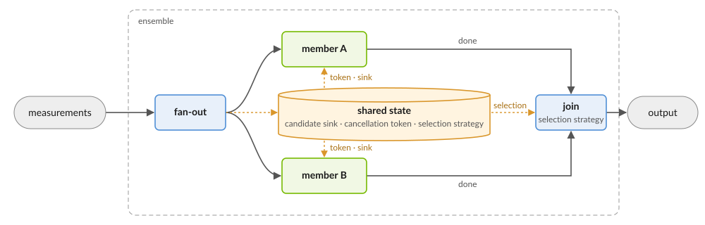

.. _task_graph_ensemble:

Task Graph Decoder Ensembles
----------------------------

An ``ensemble`` task graph runs several member graphs on the same input at
the same time and keeps one answer. Use it to orchestrate decoders that trade speed
for accuracy differently, or to bound the time to an answer with a deadline.

This page builds on :doc:`decoding_task_graph`.

How it works
++++++++++++

         and B. A join applies the selection strategy once the members are
         done and emits the output. The fan-out, the members and the join
         share one state, the candidate sink, the cancellation token and the
         selection strategy, drawn as a store between them.

* Every member receives the ensemble's input and decodes it concurrently.
* A member's answer is a *candidate*: a ``logical_outcome``, the id of the
  node that produced it and, when the decoder reports one, a *cost*, lower
  being better.
* The *selection strategy*, specified by ``join_strategy``, sees every candidate as
  it arrives and decides which one to keep. Once it decides, the other members
  are asked to stop. The ``done`` edges only order the join after every
  member has finished; candidates travel through the shared sink.
* The ensemble's ``output`` is the ``logical_outcome`` selected by the strategy.
  Every member must answer with a ``logical_outcome`` of the same size. If no
  candidate is kept, the run throws.

Configuration
+++++++++++++

This ensemble races PyMatching against the NV-qLDPC decoder and keeps the
cheapest answer available 200 microseconds after each shot arrives:

.. code-block:: yaml

   nodes:
     - id: ens
       type: ensemble
       join_strategy: deadline
       join_params: {deadline_us: 200}
       members:
         - nodes: [{id: a, type: single_window, inner: {type: pymatching}}]
           edges: [{from: input, to: a}, {from: a, to: output}]
         - nodes:
             - {id: b, type: single_window, inner: {type: nv-qldpc-decoder}}
           edges:
             - {from: input, to: b}
             - {from: b, to: output}
   edges:
     - {from: measurements, to: ens}
     - {from: ens, to: output}

.. list-table::
   :header-rows: 1
   :widths: 25 75

   * - Parameter
     - Meaning
   * - ``members``
     - The member graphs, each a list of nodes and the edges among them.
       Members name the ensemble's input ``input`` and their answer
       ``output``. Required.
   * - ``join_strategy``
     - How the answer is chosen. ``first`` keeps the first converged
       candidate. ``deadline`` keeps the cheapest candidate seen by
       ``deadline_us`` after the run starts, or the first candidate when none
       carries a cost, and decides sooner if every member finishes first.
       Required.
   * - ``join_params``
     - The strategy's parameters. ``first`` takes none. ``deadline`` takes
       ``deadline_us`` (required) and ``soft_stop_before_us``, which asks
       members to wind down that long before the deadline.
       ``decoder_param_schema("selection_strategy.<name>")`` describes them.
   * - ``cancellable``
     - On a member's window node: pass the run's cancellation token to the
       node's decoder, so it can stop when asked. Default ``false``.
   * - ``push_candidates``
     - On a member's window node: push each outcome as a candidate itself,
       instead of through an edge to ``output``. Default ``false``.

Cancellation is cooperative. A decoder that never checks its token runs to
completion and delays the result; a decoder that honors a stop may
return ``std::nullopt`` if a result is not ready before the stop is requested.

Building a graph in code
++++++++++++++++++++++++

The same graph, built with
:meth:`~cudaq_qec.DecodingTaskGraph.from_topology` from window node configs
``a`` and ``b``:

.. tab:: Python

   .. code-block:: python

      def edge(from_node, to_node):
          e = qec.task_graph_edge()
          e.from_node, e.from_output = from_node, "output"
          e.to_node, e.to_input = to_node, "input"
          return e

      ens = qec.TaskGraphEnsembleSpec()
      ens.join_strategy = "deadline"
      ens.join_params = {"deadline_us": 200}
      ens.add_member([a], [edge("input", "a"), edge("a", "output")])
      b.node_params = {"cancellable": True}
      ens.add_member([b], [edge("input", "b"), edge("b", "output")])

      node = qec.TaskGraphNodeConfig()
      node.id = "ens"
      node.kind = "ensemble"
      node.ensemble = ens
      graph = qec.DecodingTaskGraph.from_topology([node])

.. tab:: C++

   .. code-block:: cpp

      task_graph_ensemble_spec ens;
      ens.join_strategy = "deadline";
      ens.join_params.insert("deadline_us", 200);
      task_graph_ensemble_spec::member ma, mb;
      ma.nodes.push_back(std::move(a));
      ma.edges = {{"input", "output", "a", "input"}, {"a", "output", "output", "input"}};
      b.node_params.insert("cancellable", true);
      mb.nodes.push_back(std::move(b));
      mb.edges = {{"input", "output", "b", "input"}, {"b", "output", "output", "input"}};
      ens.members.push_back(std::move(ma));
      ens.members.push_back(std::move(mb));

      task_graph_node_config node;
      node.id = "ens";
      node.kind = "ensemble";
      node.ensemble = std::move(ens);
      std::vector<task_graph_node_config> nodes;
      nodes.push_back(std::move(node));
      auto graph = decoding_task_graph::from_topology(std::move(nodes));

Extending ensembles
+++++++++++++++++++

The hooks below are for decoder and plugin authors.

Reporting a cost
~~~~~~~~~~~~~~~~

A window node reads the cost from the ``cost`` key of its decoder's
``opt_results``, as a ``double``.

.. tab:: Python

   .. code-block:: python

      def decode(self, syndrome):
          r = qec.DecoderResult()
          # ...
          r.opt_results = {"cost": float(weight_of(r.result))}
          return r

.. tab:: C++

   .. code-block:: cpp

      decoder_result my_decoder::decode(const std::vector<float_t> &syndrome) {
        decoder_result r = /* ... */;
        r.opt_results = cudaqx::heterogeneous_map{};
        r.opt_results->insert("cost", weight_of(r.result));
        return r;
      }

Honoring cancellation
~~~~~~~~~~~~~~~~~~~~~

A C++ decoder overrides ``decode(syndrome, cancellation_token)`` and may return
``std::nullopt`` if a stop is requested before a result is ready. The token
has two levels, *soft* and *hard*, and only ever escalates; a decoder chooses
which level it reacts to where it polls.

.. code-block:: cpp

   std::optional<decoder_result>
   my_decoder::decode(const std::vector<float_t> &syndrome,
                      cancellation_token tok) {
     for (int iter = 0; iter < max_iters; ++iter) {
       if (tok.stop_requested())   // soft or hard; pass
         return std::nullopt;      // cancellation_level::hard to ignore soft stops
       /* one iteration */
     }
     return decode(syndrome);
   }

Pushing candidates
~~~~~~~~~~~~~~~~~~

Every run owns one *candidate sink*, a thread-safe queue. A node that accepts
a ``candidate_sink`` input receives it and may push as many candidates as it
likes; such a member must not also reach ``output``. A window node with
``push_candidates: true`` pushes each outcome this way:

.. code-block:: yaml

   - nodes:
       - id: b
         type: single_window
         inner: {type: my_decoder}
         push_candidates: true     # takes the run's sink; pushes each outcome
         cancellable: true         # takes the run's token; stops when asked
     edges:
       - {from: input, to: b}      # no edge to output: b pushes for itself

A C++ node kind pushes from its own code:

.. code-block:: cpp

   const auto &sink = inputs[sink_slot].get<candidate_sink>();
   sink.push(outcome, id_, cost);   // cost is optional

Adding a selection strategy
~~~~~~~~~~~~~~~~~~~~~~~~~~~

A C++ module adds a strategy with ``register_selection_strategy()`` and keeps
the returned registration alive while its code is loaded. The strategy's
``offer()`` sees every candidate as it is pushed; returning a value commits
to it and stops the other members. ``finish()`` may be overridden to choose
once every member is done and nothing committed. A candidate's ``producer``
is the id of the node that pushed it, prefixed by the ensemble and member
index, such as ``ens.m1.b``; one from an edge to ``output`` reports
``ens.m0.push``.

.. code-block:: cpp

   // Commits to the first candidate from a named member.
   struct prefer_member : cudaq::qec::selection_strategy {
     std::string who;
     std::optional<logical_outcome> offer(const candidate &c) override {
       return c.producer == who ? std::optional(c.result) : std::nullopt;
     }
   };

   using namespace cudaq::qec::decoding::config;
   decoder_schema schema;
   schema.params = {{"member", param_kind::string, /*required=*/true}};
   static auto reg = cudaq::qec::register_selection_strategy(
       "prefer_member", schema,  {
         auto s = std::make_unique<prefer_member>();
         s->who = p.get<std::string>("member");
         return s;
       });
