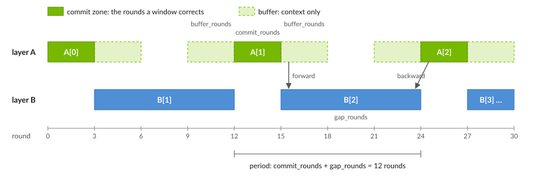
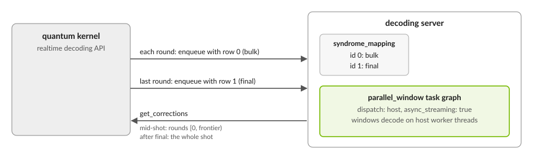
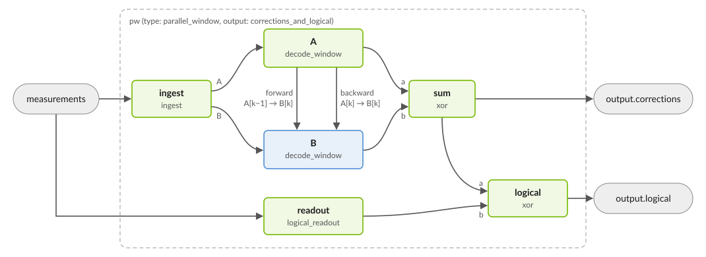

.. _task_graph_parallel_window:

Task Graph Parallel Window
--------------------------

A ``parallel_window`` task graph decodes a stream of any number of rounds in
fixed-size windows that decode at the same time. Each window is small, so the
time from a shot's last round to its result depends on the window size, not on
the shot's length. With ``async_streaming``, windows decode on the graph's
worker threads, so more threads keep up with faster rounds.

This page builds on :doc:`decoding_task_graph`.

How it works
++++++++++++

         side. Layer B windows commit the 9 rounds between consecutive A
         windows. The layout repeats every 12 rounds.

The windows form two layers:

* Each **A** window corrects ``commit_rounds`` rounds, decoding them with
  ``buffer_rounds`` of context on each side. It needs nothing from any other
  window, so it decodes as soon as its rounds arrive.
* Each **B** window corrects the ``gap_rounds`` between two A windows. It
  decodes once both neighbors have passed it their corrections at its edges.

Every round is corrected by exactly one window. Windows finish in any order,
but the graph releases corrections in round order: mid-shot, a read covers
rounds ``[0, frontier)``, the rounds whose windows have all finished. The
``FINAL`` round ends the shot and decodes the last windows.

The model
+++++++++

The graph decodes a ``dem_chunks`` model (see :ref:`dyn_dem_example`) with:

* a repeating phase, so shots may have any length;
* one round per phase;
* faults that reach at most the next round, as measurement errors do.

A phase may have no faults, such as a preparation round that no modeled
fault touches.

For surface-code memory experiments, ``memory-experiment-generator`` writes
the model and a ``parallel_window`` configuration for you; see
:doc:`/components/qec/realtime_decoding`.

Configuration
+++++++++++++

This configuration decodes a distance-5 repetition-code memory experiment:

.. literalinclude:: ../../examples/qec/yaml/task_graph_parallel_window.yaml
   :language: yaml
   :start-at: decoders:

.. list-table::
   :header-rows: 1
   :widths: 25 75

   * - Parameter
     - Meaning
   * - ``commit_rounds``
     - Rounds each A window corrects. Required.
   * - ``buffer_rounds``
     - Rounds of context on each side of an A window. Required.
   * - ``gap_rounds``
     - Rounds each B window corrects. Default:
       ``commit_rounds + 2 * buffer_rounds``.
   * - ``output``
     - ``corrections``: the correction to each logical observable. Set it;
       the default needs a logical readout in the model.
   * - ``inner``
     - The decoder every window uses, with its parameters. It must report the
       faults it finds, not only observable flips. Windows have parallel
       fault columns, so for PyMatching set
       ``merge_strategy: smallest_weight``.
   * - ``max_in_flight``
     - Windows of each layer that may decode at once. Needs
       ``async_streaming``.
   * - ``merge_identical``
     - Merge fault columns with identical effects into one. Default
       ``false``.
   * - ``verify_residual``
     - Check each window's solution against its detectors: ``none``
       (default), ``report`` a failed check in each output's ``closure``, or
       ``fail`` the graph.

A good starting point is ``commit_rounds`` and ``buffer_rounds`` equal to the
code distance, with the default ``gap_rounds``. Larger buffers give each
window more context; larger windows take longer to decode.

Advanced options
~~~~~~~~~~~~~~~~

.. include:: task_graph_provisional.rst

.. list-table::
   :header-rows: 1
   :widths: 25 75

   * - Parameter
     - Meaning
   * - ``input_boundary``
     - How an A window stands in for faults from the round before it:
       ``columns`` (default) adds one boundary fault per detector, with a
       shared prior; ``truncate`` keeps those faults, with their own priors,
       and never corrects them.
   * - ``boundary_prior``
     - The shared prior of ``columns``. Default: the largest chance that an
       odd number of the faults crossing into a detector fire.
   * - ``conflicting_parallel``
     - Fault columns that look identical in a window but flip different
       observables: ``reject`` (default) the configuration, or keep the
       ``most_likely``.

Building a graph in code
++++++++++++++++++++++++

The same graph, built with
:meth:`~cudaq_qec.DecodingTaskGraph.from_topology`:

.. tab:: Python

   .. literalinclude:: ../../examples/qec/python/task_graph_parallel_window.py
      :language: python
      :start-after: [Begin parallel_window]
      :end-before: [End parallel_window]

.. tab:: C++

   .. literalinclude:: ../../examples/qec/cpp/task_graph_parallel_window.cpp
      :language: cpp
      :start-after: [Begin parallel_window]
      :end-before: [End parallel_window]
      :dedent: 2

Decoding a shot
+++++++++++++++

Stream the shot one round at a time and tag the last round ``FINAL``:

.. tab:: Python

   .. literalinclude:: ../../examples/qec/python/task_graph_parallel_window.py
      :language: python
      :start-after: [Begin stream]
      :end-before: [End stream]

.. tab:: C++

   .. literalinclude:: ../../examples/qec/cpp/task_graph_parallel_window.cpp
      :language: cpp
      :start-after: [Begin stream]
      :end-before: [End stream]
      :dedent: 2

.. code-block:: text

   after round 30: rounds [0, 15) committed
   corrections: [1]

* With ``async_streaming``, windows decode while later rounds arrive. Without
  it, each ``enqueue_syndrome`` call finishes its windows before it returns.
* ``run`` and ``run_batch`` decode complete shots through the same windows.
  Their result's ``converged`` is true when every window's decoder converged.
* With ``verify_residual``, each output's ``closure`` in
  ``streaming_result().outputs`` is ``CLOSED`` when every window's solution
  held, ``OPEN`` when one did not, and ``NOT_CHECKED`` otherwise.

Serving with the decoding server
++++++++++++++++++++++++++++++++

         (bulk) and the last round with row 1 (final), then reads corrections
         back from the decoding server.

The decoding server serves the configuration above as written. Three settings
matter:

* **A** ``final`` **syndrome_mapping row.** The kernel tags each shot's last
  enqueue with that row's id, through ``enqueue_syndromes_mapped``. It may
  carry earlier rounds too, but must end with the shot's last round. Without
  a ``final`` row, a shot never ends.
* ``async_streaming: true``, so windows decode while rounds arrive.
* ``dispatch: host``, the default. Parallel-window graphs do not support
  ``device_graph``.

The server logs a warning for a parallel-window decoder that breaks any of
these. ``get_corrections`` returns the corrections over ``[0, frontier)``
mid-shot, and over the whole shot after the ``final`` round. See
:doc:`/components/qec/realtime_decoding` and the
:ref:`realtime decoding API <python_realtime_decoding_api>`.

What the pattern builds
+++++++++++++++++++++++

``parallel_window`` is a pattern: it builds the graph below from the
configuration above.

         its forward and backward ports, and an xor node, sum, adds both
         layers' corrections for the output.

Written out node by node, the same graph is below. The keys of ``ingest``'s
``windows`` block are provisional.

.. include:: task_graph_provisional.rst

.. literalinclude:: ../../examples/qec/yaml/task_graph_parallel_window_lowered.yaml
   :language: yaml
   :start-at: task_graph:
   :end-before: syndrome_mapping:
   :dedent: 4

Write the graph out to give the layers different decoders or to change the
windows themselves.

* The ``windows`` block of ``ingest`` defines each layer's windows: the
  rounds each commits and buffers, and what it receives and sends.
* ``index_offset`` maps window indices: window ``k`` of the edge's
  destination reads window ``k + index_offset`` of its source. Here, B[k]
  receives A[k-1]'s ``forward`` corrections and A[k]'s ``backward`` ones.

Sharing data across decoders
~~~~~~~~~~~~~~~~~~~~~~~~~~~~

.. include:: task_graph_provisional.rst

A top-level ``data_artifacts`` section declares a model, a window or a Stim
DEM file once and names it wherever a block is expected:

.. code-block:: yaml

   data_artifacts:
     rep_memory:
       dem_chunks: {...}            # the model above
     pw_A:
       window:
         context: rep_memory        # the model the window is built on
         period: 12
         zones: {buffers: [[-3, 0], [3, 6]], commit: [0, 3]}
         ports:
           input: {disposition: open, prior: 0.02}
           output: {disposition: open}
         sends: [{id: forward}, {id: backward}]
   decoders:
     - id: 0
       dem_chunks: rep_memory
       task_graph:
         nodes:
           - id: ingest
             type: ingest
             windows:
               A: pw_A
               B: {...}             # as above
           # A, B and sum as above

Each entry is built once and shared by every decoder that names it.
