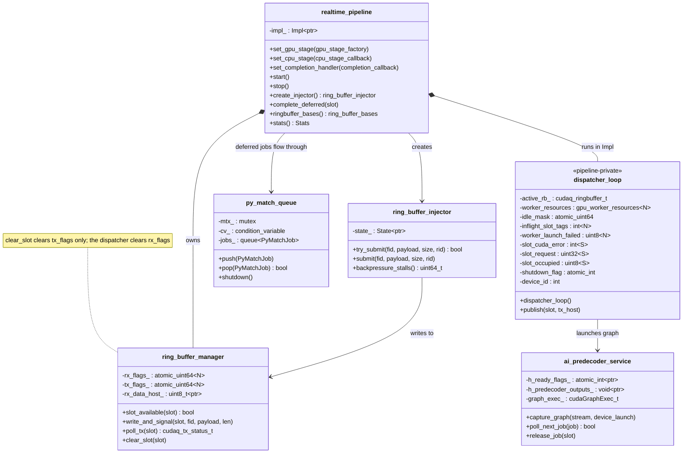
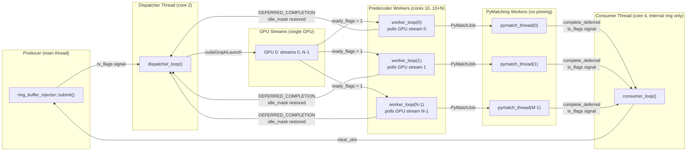
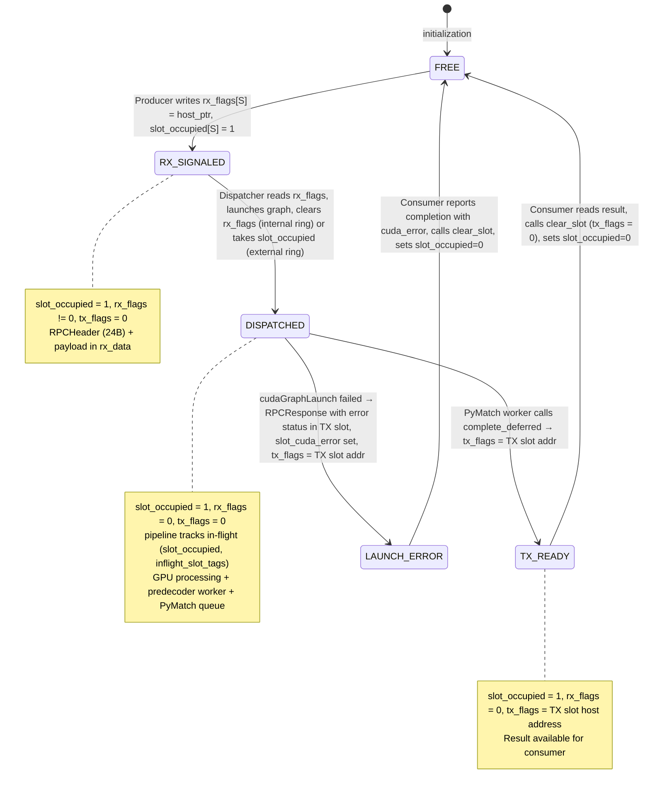
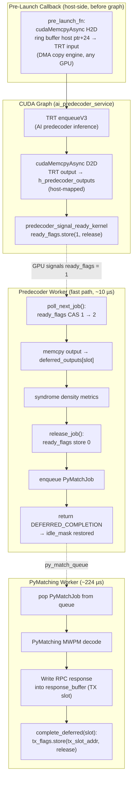
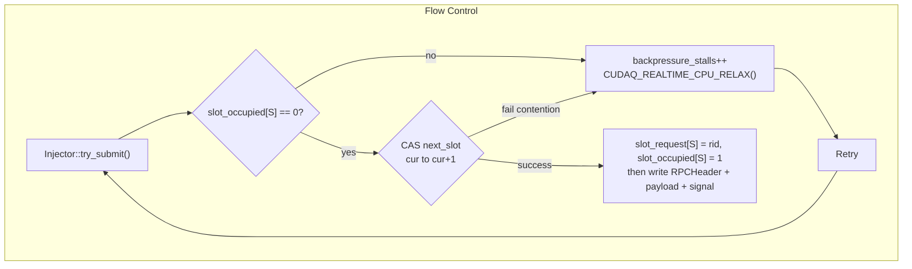
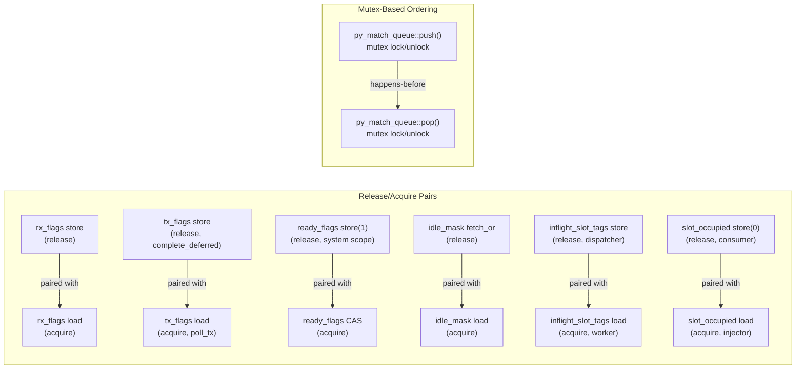
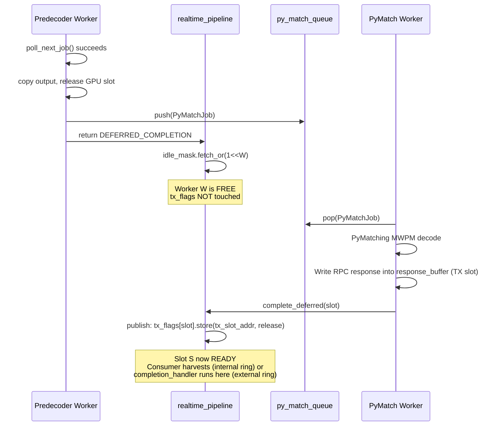

# Realtime Pipeline Architecture

## 1. Component Overview



## 2. Thread Model

The pipeline spawns four categories of threads, each pinnable to a specific CPU core.
On an external (transport-owned) ring no consumer thread is started; completions are
reported from the publishing thread, and a slot is owned by the pipeline from dispatch
until its response is published: `rx_flags[S]` keeps holding the frame and `slot_occupied[S]`
is set until `publish()` releases them (flag first). The GpuRoce transceiver publishes
into a page only once its flag is 0, so one slot carries one request at a time; its page
bytes, however, are re-armed for the next lap as soon as a frame is published, so stages
read `cpu_stage_context::request_id` / `ptp_timestamp` instead of the RX page.



**Thread counts (d13_r104 configuration):**
- Dispatcher: 1 thread (core 2)
- Predecoder workers: 8 threads (cores 10-17)
- PyMatching workers: 16 threads (unpinned)
- Consumer: 1 thread (core 4)
- Total: 26 threads

## 3. Sequence Diagram: Single Syndrome Through the Pipeline

This traces one syndrome request from submission to completion, showing every
atomic operation and the thread/device boundary crossings.

```mermaid
sequenceDiagram
    participant Prod as Producer<br>(main thread)
    participant RB as Ring Buffer<br>(shared memory)
    participant Disp as Dispatcher<br>(dedicated thread)
    participant GPU as GPU Stream w<br>(CUDA Graph)
    participant PDW as Predecoder Worker w<br>(CPU)
    participant PMQ as py_match_queue
    participant PMW as PyMatching Worker<br>(CPU)
    participant Cons as Consumer<br>(dedicated thread)
    participant App as Application<br>(completion handler)

    Note over Prod,App: === PHASE 1: Injection ===

    Prod->>Prod: CAS next_slot acq_rel, claim slot S
    Prod->>Prod: slot_request S = request_id, slot_occupied S = 1
    Prod->>RB: memcpy RPCHeader (24 bytes) + payload to rx_data S
    Prod->>RB: rx_flags S .store host_ptr, release
    Prod->>Prod: total_submitted.fetch_add 1, release

    Note over Prod,App: === PHASE 2: Dispatch ===

    Disp->>RB: rx_flags S .load acquire, sees non-zero slot S ready
    Disp->>Disp: check magic, copy function_id / request_id / ptp from RPCHeader
    Disp->>Disp: idle_mask.load acquire, find worker W via ffsll
    Disp->>Disp: inflight_slot_tags W = S, release
    Disp->>Disp: slot_dev = rx_data + offset, tx_host = tx_data_host + S * tx_stride

    opt pre_launch_fn configured
        Disp->>GPU: pre_launch_fn cudaMemcpyAsync H2D syndrome to TRT input (offset 24)
    end

    Disp->>GPU: cudaGraphLaunch graph_exec W, stream W
    Disp->>Disp: mark slot S in-flight (pipeline-private), tx_flags untouched
    Disp->>RB: rx_flags S .store 0, release, free rx slot (internal ring; an external ring holds it until publish)
    Disp->>Disp: idle_mask.fetch_and ~1 shl W, acq_rel, mark W busy (after the rx clear)
    Note over Disp: Producer uses slot_occupied[] for backpressure,<br>not tx_flags

    Note over Prod,App: === PHASE 3: GPU Inference ===

    GPU->>GPU: TRT enqueueV3: AI predecoder inference (uint8 → uint8)
    GPU->>GPU: cudaMemcpyAsync D2D: TRT output to h_predecoder_outputs
    GPU->>GPU: predecoder_signal_ready_kernel: ready_flags.store 1, release

    Note over Prod,App: === PHASE 4: Predecoder Worker (fast path, ~10 µs) ===

    PDW->>PDW: poll_next_job: ready_flags CAS 1 to 2, acquire
    PDW->>PDW: memcpy h_predecoder_outputs to deferred_outputs[S]
    PDW->>PDW: compute syndrome density metrics
    PDW->>PDW: release_job: ready_flags.store 0, release
    PDW->>PDW: read request_id from RPCHeader in host RX slot S
    PDW->>PMQ: push PyMatchJob(S, request_id, response_buffer = TX slot S)
    PDW->>PDW: return DEFERRED_COMPLETION
    PDW->>Disp: idle_mask.fetch_or 1 shl W, release, worker W free

    Note over Prod,App: === PHASE 5: PyMatching Decode (~224 µs) ===

    PMW->>PMQ: pop PyMatchJob
    PMW->>PMW: acquire per-thread decoder (thread_local)
    PMW->>PMW: read deferred_outputs[S]: logical_pred + residual detectors
    PMW->>PMW: PyMatching MWPM decode over full H matrix
    PMW->>PMW: project corrections onto observable O
    PMW->>RB: write RPCResponse + DecodeResponse into response_buffer (TX slot S)
    PMW->>RB: complete_deferred(S): tx_flags S .store tx_slot_addr, release

    Note over Prod,App: === PHASE 6: Completion ===

    Cons->>RB: poll_tx S: tx_flags S .load acquire, any non-zero = READY
    Cons->>App: completion_handler request_id, slot, success = slot_cuda_error S == 0
    Cons->>Cons: total_completed.fetch_add 1, relaxed
    Cons->>RB: clear_slot S: tx_flags = 0
    Cons->>Cons: slot_occupied S = 0, release
    Note over Prod: Slot S now available for next submission
    Note over PMW,App: External ring: no Consumer thread. publish() calls<br>completion_handler on the publishing thread, hands the RX slot<br>back (rx_flags S = 0, then slot_occupied S = 0) and the<br>transport's TX kernel consumes and clears tx_flags
```

## 4. Atomic Variables Reference

Every atomic used in the pipeline, its scope, who writes it, who reads it,
and the memory ordering used.

### Ring Buffer Flags

| Atomic | Type | Scope | Writer(s) | Reader(s) | Ordering |
|--------|------|-------|-----------|-----------|----------|
| `rx_flags[slot]` | `cuda::atomic<uint64_t, system>` | Producer ↔ Dispatcher | Producer (signal), Dispatcher (clear, internal ring), `publish()` (clear, external ring) | Dispatcher (poll) | store: `release`, load: `acquire` |
| `tx_flags[slot]` | `cuda::atomic<uint64_t, system>` | Publisher ↔ Consumer / transport | Worker thread, PyMatch worker (via `complete_deferred`), GPU-only callback, dispatcher launch-failure path (TX slot host address); Consumer (clear, internal ring) or transport TX kernel (clear, external ring) | Consumer (poll, internal ring) or transport TX kernel (external ring). Not used for producer backpressure. | store: `release`, load: `acquire` |

### Worker Pool Scheduling

| Atomic | Type | Scope | Writer(s) | Reader(s) | Ordering |
|--------|------|-------|-----------|-----------|----------|
| `idle_mask` | `cuda::atomic<uint64_t, system>` | Dispatcher ↔ Pipeline Workers | Dispatcher (clear bit; in GPU-only mode also set bit after publishing the response of a failed launch), worker thread w (set bit w after the CPU stage returns a result, DEFERRED_COMPLETION or a launch failure), GPU-only callback (set bit after publishing) | Dispatcher (find free worker) | fetch_and: `acq_rel`, fetch_or: `release`, load: `acquire` |
| `inflight_slot_tags[w]` | `int` (atomic builtins) | Dispatcher → Worker w | Dispatcher | Worker w | store: `release`, load: `acquire` |
| `worker_launch_failed[w]` | `uint8_t` (atomic builtins) | Dispatcher → Worker w | Dispatcher (set), Worker w (exchange to 0) | Worker w | store: `release`, exchange: `acq_rel` |

### GPU ↔ CPU Handoff (per ai_predecoder_service)

| Atomic | Type | Scope | Writer(s) | Reader(s) | Ordering |
|--------|------|-------|-----------|-----------|----------|
| `ready_flags[0]` | `cuda::atomic<int, system>` | GPU kernel ↔ Predecoder worker | GPU kernel (0→1), Worker (CAS 1→2), Worker (2→0 via release_job) | Worker (CAS poll) | store: `release`, CAS success: `acquire`, CAS fail: `relaxed` |

### Pipeline Lifecycle

| Atomic | Type | Scope | Writer(s) | Reader(s) | Ordering |
|--------|------|-------|-----------|-----------|----------|
| `shutdown_flag` | `cuda::atomic<int, system>` | Main ↔ Dispatcher | Main thread | Dispatcher loop | store: `release`, load: `acquire` |
| `producer_stop` | `std::atomic<bool>` | Main ↔ Consumer/Injector | Main thread | Consumer, Injector | store: `release`, load: `acquire` |
| `consumer_stop` | `std::atomic<bool>` | Main ↔ Consumer/Workers | Main thread | Consumer, Workers | store: `release`, load: `acquire` |
| `total_submitted` | `std::atomic<uint64_t>` | Injector ↔ Consumer | Injector | Consumer | fetch_add: `release`, load: `acquire` |
| `total_completed` | `std::atomic<uint64_t>` | Consumer ↔ Main | Consumer (internal ring) / publishing thread (external ring) | Main (stats) | fetch_add: `relaxed`, load: `relaxed` |
| `backpressure_stalls` | `std::atomic<uint64_t>` | Injector ↔ Main | Injector | Main (stats) | fetch_add: `relaxed`, load: `relaxed` |
| `started` | `std::atomic<bool>` | Main thread | start()/stop() | destructor, start() | implicit seq_cst |
| `stopped` | `std::atomic<bool>` | Main thread | stop() | start() (throws: a pipeline is single use) | implicit seq_cst |

### Injector Slot Claiming

| Atomic | Type | Scope | Writer(s) | Reader(s) | Ordering |
|--------|------|-------|-----------|-----------|----------|
| `next_slot` | `std::atomic<uint32_t>` | Injector-internal | try_submit (CAS) | try_submit | CAS: `acq_rel` / `relaxed` |

## 5. Ring Buffer Slot State Machine

Each of the N ring buffer slots transitions through these states. The
transitions are driven by atomic flag writes from different threads.



**`tx_flags` value encoding:**

| Value | Meaning |
|-------|---------|
| `0` | No response published: slot free, or in flight (the pipeline tracks in-flight slots in its own state) |
| Non-zero | READY — host address of the TX slot holding the `RPCResponse` (the RX slot itself on the in-place internal ring). A launch error is reported in `RPCResponse::status` and `completion::cuda_error`, not in the flag |

**Producer backpressure** uses `slot_occupied[]` (not `tx_flags`), matching the hsb model where `ring_flag`/`rx_flags` is the sole sender-side backpressure mechanism.

## 6. CUDA Graph Structure (per Worker)

Each worker has a pre-captured CUDA graph that executes on its dedicated stream.
The graph is instantiated once at startup and replayed for every syndrome.



## 7. Backpressure and Flow Control

The pipeline uses implicit backpressure through slot availability:



Backpressure uses `slot_occupied[]` (a host-side byte vector set by the producer, cleared by the consumer) rather than `tx_flags`. This matches the hsb FPGA model where the sender checks `ring_flag`/`rx_flags` for slot availability.

**Capacity:** With `num_slots = 16` and `num_workers = 8` (predecoder) + `16` (PyMatching),
up to 16 syndromes can be in various stages of processing simultaneously. When all 16
slots are occupied (either waiting for dispatch, in-flight on GPU, being decoded by
PyMatching, or awaiting consumer pickup), the injector stalls until the consumer frees a
slot.

**Round-robin limitation:** The injector uses strict round-robin slot selection. If slot N
is busy but slot N+1 is free, the producer still stalls on slot N. This preserves FIFO
ordering but contributes to backpressure stalls (~4.6M at 104 µs injection rate, single GPU).

## 8. ARM Memory Ordering Considerations

The pipeline runs on NVIDIA Grace (ARM aarch64) which has a weakly-ordered
memory model. Key ordering guarantees:

1. **Producer → Dispatcher:** `rx_flags[S].store(release)` pairs with
   `rx_flags[S].load(acquire)`. The dispatcher sees all payload bytes written
   before the flag.

2. **Dispatcher → Worker (via GPU):** The CUDA graph launch is ordered by
   `cudaGraphLaunch` semantics. The `ready_flags` store inside the GPU kernel
   uses `cuda::thread_scope_system` + `memory_order_release`, paired with the
   worker's `compare_exchange_strong(acquire)`.

3. **Predecoder Worker → PyMatch Worker:** The `py_match_queue` uses `std::mutex`
   + `std::condition_variable`, which provide implicit acquire/release semantics.
   The `deferred_outputs[slot]` buffer is written by the predecoder worker before
   `push()` and read by the PyMatch worker after `pop()`, so the mutex guarantees
   visibility.

4. **PyMatch Worker → Consumer:** `tx_flags[S].store(release)` in
   `complete_deferred()` pairs with `tx_flags[S].load(acquire)` in `poll_tx_flag()`.
   Consumer sees the full RPC response before the ready flag.

5. **Consumer → Producer (slot recycling):** `clear_slot()` (tx_flags = 0)
   comes first, then `slot_occupied[S]` is stored 0 with release; the
   producer's acquire load of `slot_occupied` pairs with it. The order matters:
   once the producer sees a free slot it may refill it and a worker may publish
   the next response, which a late `clear_slot()` would wipe.

6. **Dispatcher → Worker (handoff):** on the internal ring the dispatcher
   clears `rx_flags[S]` before `idle_mask.fetch_and` takes the worker, so
   the slot cannot be completed and refilled while its old `rx_flag` clear
   is still pending.

7. **External ring (slot ownership):** the dispatcher stores
   `slot_occupied[S] = 1` (release) at dispatch and leaves `rx_flags[S]` set;
   `publish()` reports the completion, stores `rx_flags[S] = 0` (release) and
   then `slot_occupied[S] = 0` (release). The dispatcher loads
   `slot_occupied[S]` (acquire) before `rx_flags[S]`, so a stale flag value is
   never taken for a new frame, and does not dispatch a slot whose
   `tx_flags[S]` the transport has not cleared yet.



## 9. DEFERRED_COMPLETION Protocol

The `DEFERRED_COMPLETION` mechanism allows predecoder workers to release their
GPU stream immediately while deferring ring buffer slot completion to a later
thread (the PyMatching worker pool).



**Key invariant:** Between `DEFERRED_COMPLETION` and `complete_deferred()`, the ring
buffer slot remains in the DISPATCHED state (`tx_flags = 0`, slot tracked in-flight by the
pipeline with `slot_occupied = 1`). The slot's data area is safe to read/write because the
consumer only harvests when `tx_flags` becomes non-zero, and the producer cannot reuse the
slot while `slot_occupied != 0`. The worker's GPU stream is reused immediately, so a stage
copies the predecoder output it needs before returning `DEFERRED_COMPLETION`.
